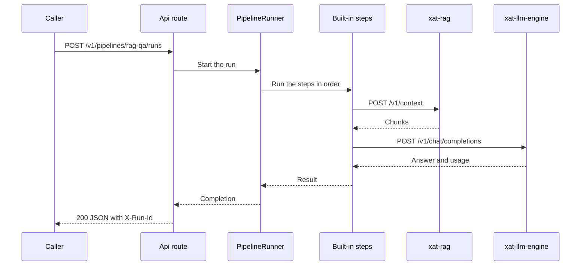
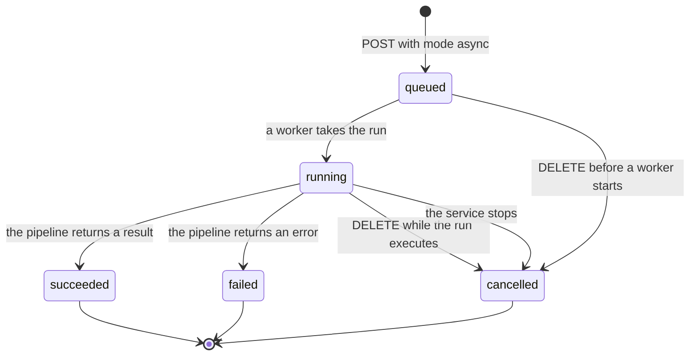

# Architecture

This page is for maintainers of xat-workflow-orchestrator. It describes the glossary, the layers, the ports and adapters, the run lifecycle and the extension points. The [API reference](api.md) lists the routes and the settings.

- [Glossary](#glossary)
- [Layers](#layers)
- [Ports and adapters](#ports-and-adapters)
- [Run lifecycle](#run-lifecycle)
- [Asynchronous runs and webhooks](#asynchronous-runs-and-webhooks)
- [Pipeline model](#pipeline-model)
- [Extension points](#extension-points)
- [Errors](#errors)
- [Decisions](#decisions)
- [Known limits](#known-limits)

## Glossary

| Term | Meaning |
|---|---|
| Pipeline | A named list of steps. Each pipeline is one YAML file in the `Pipelines:Folder` folder. |
| Step | One action in a pipeline. The `uses` key sets the step type. |
| Run | One execution of a pipeline for one request. |
| Retrieval alias | A short name for one xat-rag context and a default number of chunks. The settings are in `Retrieval:Profiles`. |
| Model alias | A short name for one model of xat-llm-engine. The settings are in `Llm:Models`. |
| Chunk | A part of a document that xat-rag returns. The prompt numbers each chunk as a source. |
| Upstream service | xat-rag, which gives chunks, or xat-llm-engine, which gives answers. |
| Caller | A program that sends requests to the orchestrator. |
| Async run | A run that a caller submits with `mode=async`. The caller reads the result later, or the result goes to a webhook. |
| Webhook | An HTTP POST that sends the result of an async run to a receiver. |

## Layers

The orchestrator has four layers. Dependencies point inward only.

| Layer | Project | Holds | May use |
|---|---|---|---|
| Domain | `src/Xat.Orchestrator.Domain` | The pipeline definition, the run results, the chunks, the answers, the errors and the run and webhook states. | Only the base class library. |
| Application | `src/Xat.Orchestrator.Application` | The pipeline engine, the steps, the ports, the validators and the async run service. | The Domain layer. |
| Infrastructure | `src/Xat.Orchestrator.Infrastructure` | The adapters to the upstream services, the YAML reader, the template store, the run store, the webhook sender and the settings. | The Application and Domain layers. |
| Api | `src/Xat.Orchestrator.Api` | The routes, the JSON contracts, the error mapping, the admission control, the listen check, the workers and the ingestion proxy. | The Application layer. The Infrastructure layer only in the start code. |

The tests in `tests/Xat.Orchestrator.Architecture.Tests/` enforce these rules:

- The Domain layer references only `System.Collections`, `System.Runtime` and `System.Text.Json`.
- The Domain layer uses no type from the outer layers, and no type from `Microsoft.Extensions`, `Microsoft.AspNetCore` or `System.Net.Http`.
- The Application layer uses no type from the Infrastructure or Api layers, and no ASP.NET Core type. It uses no YAML, Fluid, Polly or `Microsoft.Extensions.Http` library.
- The Infrastructure layer uses no type from the Api layer, and no ASP.NET Core type.
- The Infrastructure layer has three public types: `ConfigurationFilesException`, `DependencyInjection` and `XatRagEndpoint`. The adapters are reached only through their ports.
- The Api layer uses the Infrastructure layer only in `Program` and in the `Hosting` folder.
- The types in `Application.Abstractions` are interfaces or records.

## Ports and adapters

The Application layer defines the ports in `src/Xat.Orchestrator.Application/Abstractions/`. The adapters implement them.

| Port | Adapter | Notes |
|---|---|---|
| `IRetrievalClient` | `XatRagRetrievalClient` | Calls `POST /v1/context` on xat-rag. The text of each chunk is wrapped as untrusted text. |
| `ILlmClient` | `ParallelLimitedLlmClient`, which wraps `XatEngineLlmClient` | Calls `POST /v1/chat/completions` on xat-llm-engine. The wrapper applies the `Parallel` limit of the model. The adapter writes the request by hand and sends only the allowed fields. |
| `IModelCatalog` | `ConfigModelCatalog` | Model aliases from the `Llm` settings. |
| `IRetrievalProfiles` | `ConfigRetrievalProfiles` | Retrieval aliases from the `Retrieval` settings. |
| `IPipelineCatalog` | `YamlPipelineCatalog` | Reads and checks all pipeline files at start. |
| `IPromptTemplateStore` | `FluidPromptTemplateStore` | Parses all template files at start. |
| `IRunStore` | `InMemoryRunStore` | Keeps the records of async runs. A restart removes them. |
| `IWebhookPolicy` | `WebhookPolicy` | Decides which addresses can receive a webhook. |
| `IWebhookSender` | `HttpWebhookSender` | Sends a webhook with retries and a time limit. |
| `IWebhookPayloadWriter` | `WebhookPayloadWriter`, in the Api layer | Writes the webhook body in the same form as the public API. |
| `IListenAddresses` | `ServerListenAddresses`, in the Api layer | Gives the addresses that the server bound. |
| `IIngestionTarget` | `XatRagIngestionTarget`, in the Api layer | Gives the current address of xat-rag to the ingestion proxy. It uses `XatRagEndpoint` from the Infrastructure layer. |

Each upstream adapter gets a named HTTP client from the `IHttpClientFactory`. The Infrastructure layer sets the retries and the time limit of each upstream there. The address of an upstream comes from one locator. The locator uses the fixed `BaseUrl`, or it reads the ready file.

The engine types `IStepRegistry` and `IRunEventSink` are not ports. They live in `Engine/`.

## Run lifecycle

A run starts when the Api layer receives a POST request to a run route. The steps are these:

1. The route checks the pipeline name, the body, the `mode` and the stream mode.
2. `RunStarter` checks the stream mode with `RunAdmission`. Then it asks `PipelineRunner` to start the run.
3. `PipelineRunner` creates the run ID and the state. For a stream, it creates a bounded channel for the events. It starts the work in the background and returns a handle at once.
4. A sync route waits for the result. A stream route reads the events and writes them as server-sent events.
5. The runner emits `run.started` and calls the start hooks. Then it checks the input against the input schema.
6. For each step, the runner emits `step.started`, resolves the expressions and calls the step through the middleware.
7. The runner handles the outcome of the step. `Continue` goes to the next step. `Complete` ends the run with an answer. `Fail` ends the run with an error.
8. The runner emits the last event, `run.completed` or `run.error`, closes the channel and calls the completion hooks.

A sync run with xat-rag and xat-llm-engine:



A streamed run sends the status 200 before the first event. A later failure is a `run.error` event, and the status stays 200. An async run uses the same runner and the same steps. It differs in how the route starts it and where the result is stored.

## Asynchronous runs and webhooks

The async route checks the request and stores the run in the state `queued`. It then returns 202. The service creates the run ID before the run starts, so the stored record and the run share one ID.

These parts do the work:

- `AsyncRunService` in the Application layer checks the input and the webhook address at submit. It also cancels runs and queues the webhooks.
- `RunQueue` holds the waiting runs and the cancel tokens of the running runs under one lock.
- `RunExecutor` runs the pipelines. The Api layer starts `Jobs:Workers` of them.
- `WebhookDeliveryQueue` holds the finished runs that wait for delivery. It has its own workers, so a slow receiver does not hold a run worker.
- `InMemoryRunStore` keeps the records and removes old finished runs.

### State diagram



A run ends in `cancelled` with the error code `run.service_stopped` when the service stops. A queued run that the service stops is lost, because the store is in memory.

Each change of a run is one atomic update in the store. A cancel and a worker that starts the same run cannot overwrite each other. A finished run does not change again.

The webhook has its own state. It is `pending` from the submit until the delivery ends. Then it becomes `delivered` or `failed`. So the `webhook` field of a finished run changes after the run ends. The run state does not change with it.

## Pipeline model

- **Definition.** `YamlPipelineReader` reads a file into a `PipelineDefinition`. `PipelineDefinitionValidator` checks each definition at start.
- **State.** `PipelineState` holds the data of one run. It has the input, the prompt draft, the results of each step, the warnings and the token usage. Typed keys hold the values that the built-in steps share. Runs never share a state.
- **Steps.** A step implements `IPipelineStep<TOptions>`. It returns a `StepOutcome`. An expected failure is an outcome, not an exception. The engine binds the `with` block to the options class. An unknown key is an error. A step can also implement `IStepValidator<TOptions>`, so that the start checks its options.
- **Outcomes.** `Continue` moves on to the next step. `Complete` stores the answer and skips the other steps. `Fail` ends the run with an error. The error keeps the step ID as its source.
- **Expressions.** `ExpressionResolver` replaces the expressions before a step runs. It reads only `input.` and `steps.` paths. `ExpressionPath` holds the one rule for these paths.
- **Trust.** `prompt.assemble` escapes the text of chunks and of `prompt.context` steps. Trusted text, from `prompt.append` steps and templates, is not escaped. Never put text from the caller in trusted text.

## Extension points

### Add a step

Add a step when no built-in step does the job. A step is a class that implements `IPipelineStep<TOptions>`.

1. Create the options class and the step class in a folder under `src/Xat.Orchestrator.Application/Steps/`. Put each class in its own file.
2. Register the step in the `AddApplication` method of `src/Xat.Orchestrator.Application/DependencyInjection.cs`. Add a `using` for the namespace of the step. Then add a call to `AddPipelineStep<TStep, TOptions>(name, traits, summary)` to the chain.
3. Add a test in `tests/Xat.Orchestrator.Application.Tests/Steps/`.
4. Build and test the solution. Restart the orchestrator. The step appears in `GET /v1/steps`.

This example adds a suffix to the prompt of the caller:

```csharp
using Xat.Orchestrator.Application.Engine.Execution;
using Xat.Orchestrator.Application.Engine.StepContracts;

namespace Xat.Orchestrator.Application.Steps.Custom;

public sealed class TextSuffixOptions
{
    public string? Suffix { get; init; }
}

public sealed class TextSuffixStep : IPipelineStep<TextSuffixOptions>
{
    public ValueTask<StepOutcome> ExecuteAsync(StepContext context, TextSuffixOptions options, CancellationToken ct)
    {
        context.Run.State.Prompt.User += options.Suffix;
        return ValueTask.FromResult(StepOutcome.Continue);
    }
}
```

Register it in the chain of `AddPipelineStep` calls:

```csharp
.AddPipelineStep<TextSuffixStep, TextSuffixOptions>(
    "text.suffix", StepTraits.None, "Adds a suffix to the prompt of the caller.")
```

A step that calls an upstream service needs a port in `Application/Abstractions/`, an adapter in `Infrastructure/`, and a registration in `src/Xat.Orchestrator.Infrastructure/DependencyInjection.cs`. A step that calls the model must use `ILlmClient`. It cannot also have the `Idempotent` trait.

A step can return `StepOutcome.Complete` to end the run with an answer. It can return `StepOutcome.Fail` to stop the run with an error.

### Add a middleware

Middleware wraps every step. It can change the flow, so it must return a valid outcome.

1. Create a class that implements `IStepMiddleware`. Put it in `src/Xat.Orchestrator.Application/Engine/Hooks/`.
2. Register it in `AddApplication` with `AddStepMiddleware<TMiddleware>()`. The first registered middleware is the outermost. Register a new middleware after the built-in ones.

The built-in middleware are `StepActivityMiddleware`, which is the outermost, and `IdempotentRetryMiddleware`. The retry runs inside the trace span, so one span covers all the tries of a step.

### Add an observer

Observers watch runs. They cannot change the flow.

1. Create a class that implements `IPipelineObserver`. Override only the methods that you need: `OnRunStartedAsync`, `OnStepStartedAsync`, `OnStepCompletedAsync` and `OnRunCompletedAsync`.
2. Register it in `AddApplication` with `AddPipelineObserver<TObserver>()`.

Each observer call has a short time limit. An observer that fails or runs too long is logged, and the run goes on.

The built-in `RunLogObserver` writes these lines. The run start is an Information line. Each step is a Debug line, and a failed step is a Warning line with its code. The run end is an Information line, and a failed run is a Warning line. The lines hold IDs, names, times, error codes and token counts. They never hold the input, the prompt, the chunks or the answer.

### Trace spans

`StepActivityMiddleware` starts one span for each step. The span covers all the tries of a step. The source name is `Xat.Orchestrator.Pipelines`. The spans have these tags: `pipeline.run.id`, `pipeline.name`, `pipeline.step.id`, `pipeline.step.uses`, and `error.code` after a failure. A failed span has the status Error.

The orchestrator does not add an exporter. A listener on the source name can collect the spans.

### Settings and YAML only

A new retrieval alias, a new model alias and a new pipeline need no code change. Add them to the settings or to the `pipelines/` folder. See [Settings](api.md#settings) and [Pipeline files](api.md#pipeline-files).

To send a new request field to xat-llm-engine, add it to `BuildRequest` in `src/Xat.Orchestrator.Infrastructure/XatLlmEngine/XatEngineLlmClient.cs`. Then list the field in `AllowedFields` of the model.

## Errors

Each expected failure is a `PipelineError`. It has a code, a message, a kind, an optional retry time and an optional source. The kind decides the HTTP status and the `type` of the error. The Api layer maps each kind. The codes are listed in the [error table](api.md#errors).

The adapters map the errors of the upstream services. No upstream type and no upstream status leave the adapter. The upstream error becomes a `PipelineError` with a code that names the upstream.

An exception means a bug. `GlobalExceptionHandler` logs it and returns `internal.error` with no details. Error messages never show exception text.

The ingestion proxy uses YARP's `IHttpForwarder`. It has one endpoint for each of the seven routes. `IngestionRawPath` keeps the text of a document ID exact. `IngestionTransformer` keeps a short list of request headers and sets the `Host` header. Each request reads the address of xat-rag again, because the port can change at each start.

## Decisions

| Decision | Reason |
|---|---|
| A thin pipeline engine, not a workflow framework. | A pipeline needs ordered steps, expressions and observers only. A small engine is easier to read, test and change. |
| Pipelines are YAML files that the start checks. | An operator changes a pipeline without a build. A mistake stops the start, so it never reaches a request. |
| No authentication. Loopback is the only protection. | The project owner decided this. A network address would let other machines call the orchestrator without any check. |
| A hand-written LLM adapter, not Microsoft.Extensions.AI. | The engine refuses top-level fields that it does not list. The adapter must control each field that it sends. |
| Polly only in the adapters. | Retry and time rules belong to the calls to the upstream services and to the webhooks. The Application layer stays free of resilience libraries. |
| Fluid for the prompt templates. | Fluid gives templates no access to .NET objects, so an edited template cannot run code. |
| An own JSON Schema subset. | The subset covers the input checks. The start rejects any other keyword, so no rule goes unenforced. |
| No chat completions, model list or token counting. | Those jobs belong to xat-llm-engine. The engine decides the prompt size limits. |
| Async runs live in memory. | The project owner decided this. The scope is thin, so no database is needed for the runs. |
| Webhooks have their own workers, and they go only to allowed addresses. | A slow receiver must not block runs. A webhook must not reach a private route. Redirects are not followed, because a redirect could reach a refused address. |
| The ingestion proxy forwards seven fixed routes, and it reads the address of xat-rag for each request. | Other xat-rag paths never get a request. A port that changes at each start is found again on the next request. |
| The limit on calls per model applies to the model ID, not to the alias. | The engine runs the model. Two aliases for one model must share one limit. |

## Known limits

- **No prompt size limit.** The prompt holds every chunk of a retrieval. Keep the number of chunks low enough for the model.
- **No idle timeout for a stream.** A caller that stops reading keeps the connection open. The caller must close the connection.
- **Async runs are lost on a stop.** The store is in memory. A stop removes queued and running runs, and it leaves webhooks pending. Read the results before a restart.
- **Finished runs leave the store.** A finished run is removed after the retention time, or when the store has too many finished runs. Read results in time, or use a webhook.
- **Webhooks are not signed.** Delivery is at least once. The receiver must ignore a repeat. A failed webhook is not sent again.
- **The webhook port rule skips ready-file upstreams.** A webhook can reach the port of an upstream that uses a ready file. Do not send a webhook to that port.
- **Host names are checked by name only.** A host name in `Webhooks:AllowedHosts` can resolve to any address. Allow only host names that you trust.
- **Settings and pipelines load once.** The orchestrator does not reload them while it runs. Restart the orchestrator after you change a file.
