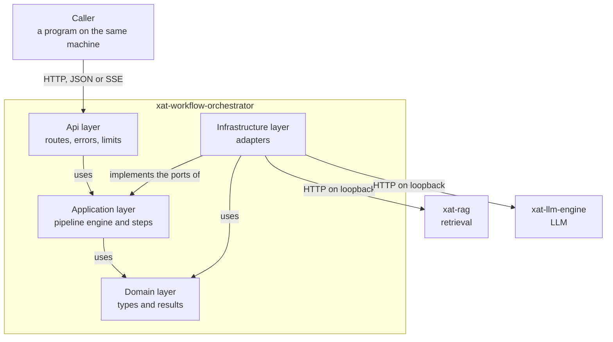
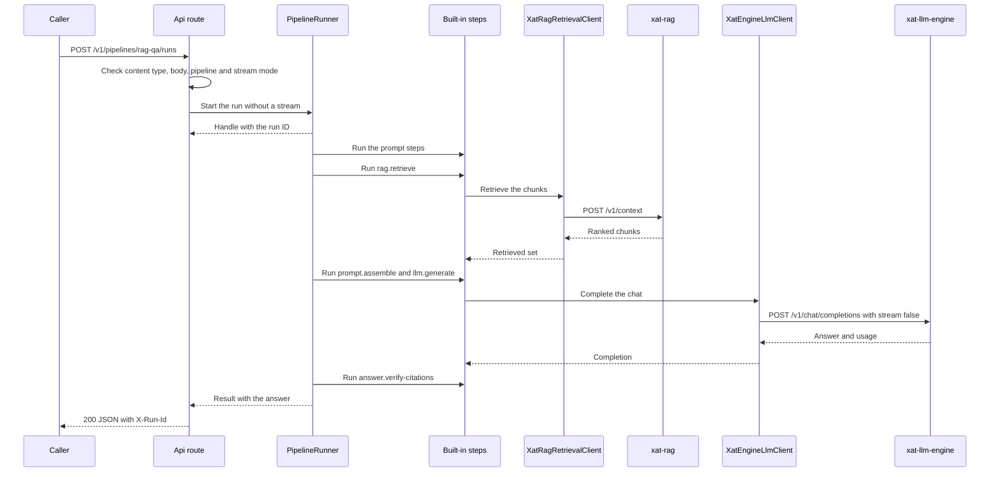
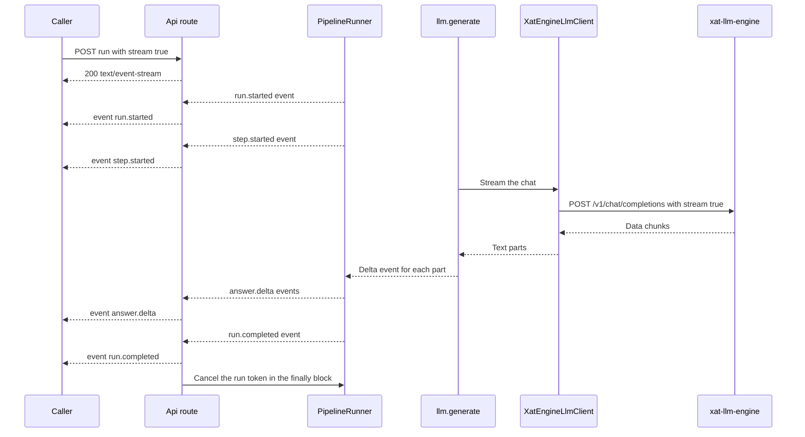
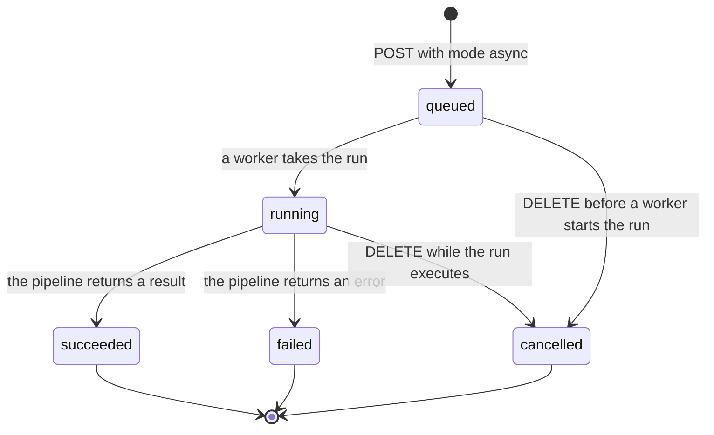
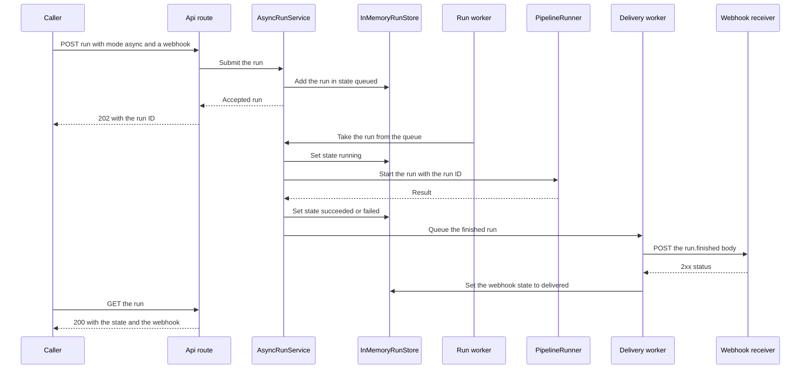
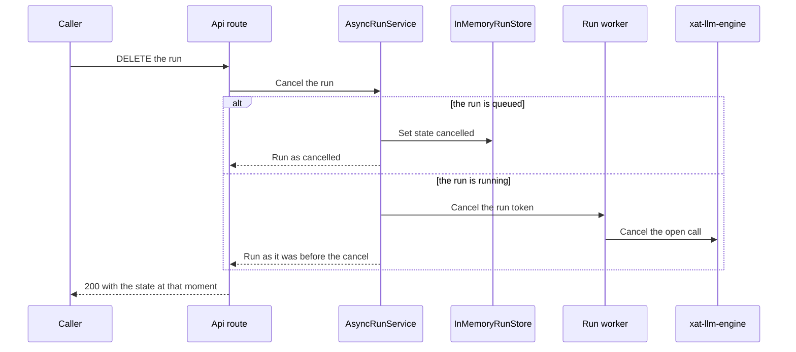
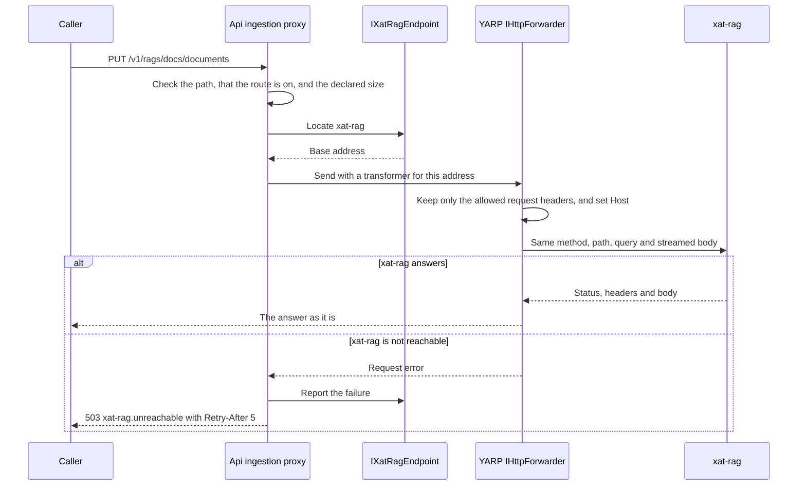

# Architecture

xat-workflow-orchestrator runs a pipeline for each request of a caller. A pipeline is a named list of steps. The steps are defined in YAML files. Some steps call xat-rag for retrieval, and some call xat-llm-engine for the LLM. The orchestrator returns the answer as one JSON body, or as server-sent events. A caller can also start a run in the background. The orchestrator then returns a run ID at once, and it can send the result to a webhook.

The orchestrator also forwards seven ingestion routes to xat-rag. It does not offer chat completions, a model list or token counting. Those jobs belong to xat-llm-engine.

This page explains the layers, the run lifecycle and the extension points. The [API reference](api.md) lists the routes and the settings. The [quickstart](quickstart.md) shows how to start the orchestrator.

- [System overview](#system-overview)
- [Layers](#layers)
- [Folders](#folders)
- [Ports and adapters](#ports-and-adapters)
- [Run lifecycle](#run-lifecycle)
- [Asynchronous runs and webhooks](#asynchronous-runs-and-webhooks)
- [Ingestion proxy](#ingestion-proxy)
- [Pipeline model](#pipeline-model)
- [Extensibility](#extensibility)
- [Error model](#error-model)
- [Security](#security)
- [Decisions](#decisions)
- [Known limits](#known-limits)
- [Not built yet](#not-built-yet)

## System overview

The Api layer is the only layer that the caller reaches. The Infrastructure layer is the only layer that reaches the upstream services.

## Layers

The orchestrator has four layers. Dependencies point inward only:

- The Api layer uses the Application layer. It also uses the Infrastructure layer, but only in the start code, to register the adapters.
- The Infrastructure layer uses the Application layer, because its adapters implement the ports of the Application layer.
- The Application layer uses the Domain layer.
- The Domain layer uses no other project of the orchestrator.

The architecture tests in `tests/Xat.Orchestrator.Architecture.Tests/` enforce these rules. They also check that the Domain layer uses no framework type, and that the Application layer uses none of the YAML, template or resilience libraries.

| Layer | Project | What it holds | Uses |
|---|---|---|---|
| Domain | `src/Xat.Orchestrator.Domain` | The result types and the error kinds. The pipeline definition, the run result, the retrieval chunks, the answer, the citations, the model profile, the run records and the webhook states. | The base class library only. |
| Application | `src/Xat.Orchestrator.Application` | The pipeline engine, the step interfaces, the built-in steps, the ports, the definition validator, the input schema validator and the asynchronous run service. The port `IXatRagEndpoint` gives the address of xat-rag. | The Domain layer. Not the Infrastructure or Api layers, not ASP.NET Core, and not the YAML, template or resilience libraries. |
| Infrastructure | `src/Xat.Orchestrator.Infrastructure` | The adapters to xat-rag and xat-llm-engine. The class `XatRagEndpoint` implements the address port for xat-rag. The YAML reader, the template store, the configuration catalogs, the health checks, the settings and their validators. The in-memory run store and the webhook adapters. | The Application and Domain layers, and the third-party libraries for YAML, templates and resilience. |
| Api | `src/Xat.Orchestrator.Api` | The routes, the request and response types, the error mapping, the admission control, the listen address check, the program start, the background workers for runs and the webhook payload writer. It also holds the ingestion proxy. The proxy uses YARP, a reverse proxy library. | The Application layer, ASP.NET Core, the YARP library, and the Infrastructure layer for the start code. |

The Domain layer returns expected failures as values. The type `Result` and the type `PipelineError` carry the code, the message, the kind and the retry time. An exception means a bug.

## Folders

The repository has these main folders:

- `src/Xat.Orchestrator.Api/`
  - `Program.cs` starts the host. It registers the services, the admission control and the routes. It also runs the fail-fast checks.
  - `Endpoints/` has the route groups: `CatalogEndpoints.cs`, `HealthEndpoints.cs`, `RunEndpoints.cs` and `RunStatusEndpoints.cs`. `RunRules.cs` holds the rules that the run routes share, such as the rate limit policy name and the stream mode check.
  - `AsyncRunWorker.cs` starts the run workers and the webhook delivery workers. `WebhookPayloadWriter.cs` writes the webhook body.
  - `Contracts/` has the JSON settings and the request and response types.
  - `ApiErrors.cs`, `GlobalExceptionHandler.cs`, `ListenAddressPolicy.cs` and `ApiOptions.cs` hold the error mapping, the unhandled exception handler, the loopback check and the API settings. `BrowserOriginGuard.cs` refuses every request that has an `Origin` header.
  - `Ingestion/` holds the ingestion proxy. `IngestionEndpoints.cs` maps the seven routes, and `IngestionRoutes.cs` holds their names. `IngestionForwarder.cs` sends the request, and `IngestionTransformer.cs` lets only the allowed headers through. `IngestionRawPath.cs` builds the path of a delete-document request. `IngestionOptions.cs` holds the settings.
  - `appsettings.json` holds the default settings.
- `src/Xat.Orchestrator.Application/`
  - `Abstractions/` has the ports and their records.
  - `Engine/` has the runner, the state, the expression resolver, the schema validator, the step, middleware and hook interfaces, the run events and the step registry.
  - `Steps/` has one class for each built-in step, and one options class for each step.
  - `Definitions/` has the validator of pipeline definitions.
  - `Jobs/` has the asynchronous run service, its settings and the records of queued runs and pending webhooks.
  - `DependencyInjection.cs` registers the engine and the built-in steps.
- `src/Xat.Orchestrator.Domain/`
  - `Errors/`, `Generation/`, `Pipelines/`, `Retrieval/` and `Runs/` hold the types of each area.
- `src/Xat.Orchestrator.Infrastructure/`
  - `Catalogs/` has the model catalog and the retrieval profile catalog.
  - `Definitions/` has the pipeline catalog and the YAML reader.
  - `Discovery/` has the upstream address logic, the address handler and the error mapping for the upstream services.
  - `Health/` has the health checks of the upstream services.
  - `Options/` has the settings classes and their validators.
  - `Jobs/` has the in-memory run store. `Webhooks/` has the webhook policy and the webhook sender.
  - `Templates/` has the prompt template store, based on Fluid.
  - `XatRag/` has the retrieval adapter and the address class `XatRagEndpoint`. `XatLlmEngine/` has the LLM adapter.
  - `DependencyInjection.cs` registers the adapters, the HTTP clients and the retry rules.
- `pipelines/` has the YAML pipeline files. The build copies them to the output folder.
- `prompts/` has the Liquid template files. The build copies them to the output folder.
- `tests/` has five test projects: Domain, Application, Infrastructure, Api and Architecture.

## Ports and adapters

The Application layer defines the ports as interfaces in `src/Xat.Orchestrator.Application/Abstractions/`. The Infrastructure layer has the adapters.

| Port | Adapter | Source or service | Notes |
|---|---|---|---|
| `IRetrievalClient` | `XatRagRetrievalClient` | xat-rag: `POST /v1/context` | The text of each chunk is wrapped in `UntrustedText`. |
| `ILlmClient` | `XatEngineLlmClient` | xat-llm-engine: `POST /v1/chat/completions` | The adapter writes the request by hand. It sends only the fields in `AllowedFields`. |
| `IModelCatalog` | `ConfigModelCatalog` | The `Llm` settings | Model aliases. |
| `IRetrievalProfiles` | `ConfigRetrievalProfiles` | The `Retrieval` settings | Retrieval aliases. |
| `IPipelineCatalog` | `YamlPipelineCatalog` | The `Pipelines:Folder` folder | All files are read and checked at start. |
| `IPromptTemplateStore` | `FluidPromptTemplateStore` | The `Prompts:Folder` folder | Templates are parsed at start. |
| `IRunEventSink` | `ChannelRunEventSink` and `NullRunEventSink` | An in-process channel | A streamed run uses the channel. A sync run uses the null sink. |
| `IStepRegistry` | `StepRegistry` | The step registrations of the service collection | Step types by name. |
| `IRunStore` | `InMemoryRunStore` | None. The store is in memory. | Records of asynchronous runs. A restart loses them. |
| `IWebhookPolicy` | `WebhookPolicy` | The `Webhooks` settings | Decides the addresses that can receive a webhook. |
| `IWebhookSender` | `HttpWebhookSender` | HTTP POST to the receiver | Sends a webhook with Polly retries and a time limit. |
| `IWebhookPayloadWriter` | `WebhookPayloadWriter`, in the Api layer | None | Writes the webhook body in the same form as the public API. |
| `IXatRagEndpoint` | `XatRagEndpoint` | The `Upstreams:XatRag` settings, through the same locator as the retrieval adapter | Gives the current address of xat-rag to the ingestion proxy. `ReportFailure` makes the next lookup read the address again. |

Each upstream adapter uses a named HTTP client from the .NET HTTP client factory. The factory adds a retry rule and a time limit to that client. The address of the upstream comes from a locator. The locator uses the fixed `BaseUrl`, or the `ReadyFile`. See [Settings](api.md#settings).

## Run lifecycle

A run starts when the Api layer receives a POST request to a run route. The steps of the run are these:

1. The route checks the content type, the body, the pipeline name and the stream mode of the pipeline.
2. The route creates a token for the run. The token is linked to the request token, so a caller that disconnects cancels the run.
3. `PipelineRunner.Start` creates the run ID and the state. For a streamed run, it also creates a bounded channel. It starts the work in the background, and it returns a handle at once.
4. A sync route waits for the completion of the handle. A streamed route reads the events from the channel, and it writes them as server-sent events.
5. The runner emits the start event and calls the start hooks. It checks the input against the input schema.
6. For each step, the runner emits a step event, resolves the expressions, and calls the step through the middleware.
7. The runner handles the outcome of the step. A continue outcome goes to the next step. A complete outcome ends the run with an answer. A fail outcome ends the run with an error.
8. The runner emits the last event, `run.completed` or `run.error`. It closes the channel and calls the completion hooks.

A sync run with xat-rag and xat-llm-engine:

A streamed run with xat-llm-engine:

The route sets the HTTP status 200 before the first event. A later failure is a `run.error` event. The HTTP status does not change.

An asynchronous run uses the same runner and the same steps. It differs in how the route starts it and how the result is stored. See [Asynchronous runs and webhooks](#asynchronous-runs-and-webhooks).

## Asynchronous runs and webhooks

A caller starts an asynchronous run with `mode=async`. The route checks the request, stores the run in the state `queued`, and returns 202. The API is described in [Asynchronous runs](api.md#asynchronous-runs).

The service creates the run ID before the run starts. It passes this ID to the runner. The stored record and the run therefore have the same ID. The components are these:

- `AsyncRunService` in the Application layer. It checks the input and the webhook address at submit. It also runs the queue, the cancel and the webhook delivery.
- `IRunStore` and `InMemoryRunStore` in the Infrastructure layer. They hold the run records in memory.
- `IWebhookPolicy` and `WebhookPolicy`. They decide the addresses that can receive a webhook.
- `IWebhookSender` and `HttpWebhookSender`. They send the webhook with a Polly retry pipeline and a time limit.
- `AsyncRunWorker` in the Api layer. It starts `Jobs:Workers` run workers and `Jobs:WebhookWorkers` delivery workers.
- `WebhookPayloadWriter` in the Api layer. It writes the webhook body. The body has the same form as the public API.

### State machine

Each change of a run is one atomic update in the store. A finished run does not change again. The webhook has its own state. It is `pending` until the delivery ends, and then it is `delivered` or `failed`.

### Submit and webhook

### Cancel

### Atomic updates and delivery

The store runs each change under one lock. A cancel and a worker that starts the same run cannot overwrite each other. A cancel of a queued run changes the state in the store. The worker then reads the state and skips the run.

When a run ends, the service puts it in a delivery queue. Delivery workers send the webhook. They do not hold a run worker, so a slow receiver does not block the runs.

## Ingestion proxy

The ingestion proxy forwards seven routes of xat-rag. The routes are listed in [Route names and paths](api.md#route-names-and-paths). The proxy uses YARP, a reverse proxy library. The library class `IHttpForwarder` sends each request. Each request has its own destination, because the address of xat-rag can change at each start.

The proxy has these parts, all in the Api layer:

- `IngestionEndpoints` maps the seven routes. Each route has a fixed name.
- `IngestionForwarder` checks the path, the settings and the size of an upload. It then sends the request, and it maps the forwarder errors to error codes.
- `IngestionTransformer` lets only an allow-list of request headers through. It also sets the `Host` header.
- `IngestionRawPath` builds the path of a delete-document request from the original text of the request. It keeps the document ID exact, and it refuses an ID with a dot segment.
- `IXatRagEndpoint` gives the address of xat-rag. The port is in the Application layer, and the adapter is in the Infrastructure layer.

A request to the proxy follows this sequence:

The proxy copies the body in both directions without buffering it. A large upload therefore does not fill the memory of the orchestrator. A declared size above `Ingestion:MaxUploadBytes` gets 413 before any byte goes to xat-rag. For an upload without a declared size, the server stops the read at the limit. The caller gets the same 413 error. xat-rag receives an upload that ends early.

The route `GET /v1/jobs/{job_id}` looks like the run route `GET /v1/runs/{id}`, but the two serve different work. The job route reads an ingestion job of xat-rag. The run route reads an asynchronous run of the orchestrator. See [Jobs and asynchronous runs](api.md#jobs-and-asynchronous-runs).

## Pipeline model

### Definition

A pipeline definition is a `PipelineDefinition`. It has the name, the version, the summary, the stream mode, the input schema and the list of steps. `YamlPipelineReader` builds the definition from a YAML file. `PipelineDefinitionValidator` checks it at start. See [Pipeline files](api.md#pipeline-files).

### State

`PipelineState` holds the data of one run. A run has one state, and runs never share a state. The state has these parts:

- The input of the caller, as a JSON value.
- The prompt draft. It holds the system prompt, the prompt of the caller and the sections that the steps add.
- The results of each step. A later step reads them as `steps.<id>.<name>`.
- The warnings and the token usage of the run.
- Typed keys for the values that the built-in steps share: the chat messages, the answer and the sources.

### Steps

A step implements `IPipelineStep<TOptions>`. Its `ExecuteAsync` method gets the context, the options and a token. It returns a `StepOutcome`. An expected failure is an outcome, not an exception.

The engine binds the `with` block of the step to the options class. It uses the JSON options and the data annotations of the class. An unknown key is an error. A step can also implement `IStepValidator<TOptions>`, so that the start checks its options.

Each step type has traits. The traits are `CallsLlm`, `Streams`, `ProducesAnswer` and `Idempotent`. The definition validator uses the `ProducesAnswer` trait. The stream mode `required` needs a step with the `Streams` trait.

### Expressions

Before a step runs, `ExpressionResolver` replaces the expressions in its `with` block. The resolver supports lookups only. It reads `input.<path>`, `steps.<id>.<name>` and the `??` default. A text that is one expression keeps the type of the value. Other expressions become text. The start checks each path, so that a path always names a valid source.

### Outcomes

A step returns one of three outcomes:

| Outcome | Effect |
|---|---|
| `Continue` | The runner goes to the next step. |
| `Complete` | The runner stores the answer and the status, and it skips the other steps. The `flow.complete-if` step uses this outcome with the status `no_answer`. |
| `Fail` | The run ends with the error. The error keeps the step ID as its source. |

### Middleware

A middleware implements `IStepMiddleware`. It wraps each step, and it can change the flow. For example, it can skip a step, or add a time limit. The runner calls the middleware in the order of registration. The first registered middleware is the outermost.

The built-in `StepActivityMiddleware` is registered first. It starts one trace span for each step, with the name of the pipeline and the step. The source name of the spans is `Xat.Orchestrator.Pipelines`. The project does not configure an exporter.

### Hooks

A hook implements `IPipelineObserver`. It watches the run, and it cannot change the flow. The four hook methods are these:

- `OnRunStartedAsync`, when a run starts.
- `OnStepStartedAsync`, before a step.
- `OnStepCompletedAsync`, after a step, with the outcome and the time of the step.
- `OnRunCompletedAsync`, at the end of a run.

Each hook call has a time limit of 5 seconds. A hook that fails or passes its limit is logged, and the run goes on. The completion hook runs for every end of a run: success, failure, cancel and timeout.

### Streaming channel

A streamed run uses a bounded channel with 256 places. The channel has one reader and one writer. When the channel is full, the runner waits for the reader.

The runner sends these events: `Started`, `StepStarted`, `Delta`, `Citations`, `Completed` and `Failed`. The last event is always `Completed` or `Failed`. The runner waits at most 5 seconds to send the last event. After that, the run ends without sending it. The streamed run route then sends the error `run.stream_lost`.

### Cancellation and time limits

The token of a run is linked to two sources. The first source is the request token. It is cancelled when the caller disconnects. The second source is the deadline of the run, from `Runs:RunTimeout`. Each step gets this token. Each upstream call also gets the token.

- A cancel by the caller ends the run with `run.cancelled`, which has the status 499. A `DELETE` request for an asynchronous run ends it the same way.
- A passed deadline ends the run with `run.timeout`, which has the status 504.
- Each upstream call also has its own time limit, from `Upstreams:*:RequestTimeoutSeconds`. The limit covers all retries.

## Extensibility

The steps below name the files to change. Most changes need no change to the engine.

### Add a step

1. Create the options class and the step class in `src/Xat.Orchestrator.Application/Steps/`. Use one file for each class.
2. Register the step in the `AddApplication` method of `src/Xat.Orchestrator.Application/DependencyInjection.cs`. Use `AddPipelineStep<TStep, TOptions>(name, traits, summary)`.
3. Add a test in `tests/Xat.Orchestrator.Application.Tests/`.
4. Add the step to the built-in steps list in `docs/api.md`.

A step that calls an upstream service needs a port in `Application/Abstractions/`. It also needs an adapter in `Infrastructure/`. The adapter is registered in `src/Xat.Orchestrator.Infrastructure/DependencyInjection.cs`.

### Add a context

A context is a xat-rag context, with a retrieval alias for the orchestrator.

1. Add the alias under `Retrieval:Profiles` in `src/Xat.Orchestrator.Api/appsettings.json`.
2. Restart the orchestrator.

No code change is needed. The context must exist in xat-rag. The validator in `src/Xat.Orchestrator.Infrastructure/Options/RetrievalOptionsValidator.cs` checks the alias and the number of chunks.

### Add a model

A model is a model alias for xat-llm-engine.

1. Add the alias under `Llm:Models` in `src/Xat.Orchestrator.Api/appsettings.json`.
2. Restart the orchestrator.

No code change is needed for a model that uses the fields that the adapter already sends. To send a new field, add it to `BuildRequest` in `src/Xat.Orchestrator.Infrastructure/XatLlmEngine/XatEngineLlmClient.cs`, and list the field in `AllowedFields` of the model.

### Add a middleware

1. Create a class that implements `IStepMiddleware`. Put it in `src/Xat.Orchestrator.Application/Engine/`, or in the module that owns it.
2. Register it in the `AddApplication` method of `src/Xat.Orchestrator.Application/DependencyInjection.cs`, with `AddStepMiddleware<TMiddleware>()`. The new middleware goes after the built-in one.
3. Add a test in `tests/Xat.Orchestrator.Application.Tests/`.

The middleware runs for every step of every pipeline. A middleware that changes the flow must return a valid outcome.

### Add a hook

1. Create a class that implements `IPipelineObserver`. Override only the methods that you need.
2. Register it in the `AddApplication` method of `src/Xat.Orchestrator.Application/DependencyInjection.cs`, with `AddPipelineObserver<TObserver>()`.
3. Add a test in `tests/Xat.Orchestrator.Application.Tests/`.

A hook has 5 seconds for each call. Keep the work of a hook short.

### Add a pipeline

1. Create a YAML file in `pipelines/`. The file name does not set the pipeline name. The `name` key does.
2. Build the project, so that the file is copied to the output folder.
3. Restart the orchestrator.

No code change is needed. Check the new pipeline with `GET /v1/pipelines`.

## Error model

Each expected failure is a `PipelineError`. The record has a code, a message, a kind, an optional retry time and an optional source. The source names the step or the upstream service that caused the failure.

The kind decides the HTTP status and the `type` of the error body:

| Kind | Status | Type |
|---|---|---|
| `Validation` | 400 | `invalid_request_error` |
| `NotFound` | 404 | `not_found_error` |
| `Conflict` | 409 | `conflict_error` |
| `Overloaded` | 503 | `overloaded_error` |
| `RateLimited` | 429 | `rate_limit_error` |
| `Timeout` | 504 | `timeout_error` |
| `UpstreamUnavailable` | 503 | `service_unavailable_error` |
| `UpstreamFailed` | 502 | `upstream_error` |
| `Cancelled` | 499 | `cancelled_error` |
| `Internal` | 500 | `internal_error` |

The Api layer writes every error with the same body: `{"error": {"type", "message", "code", "run_id"}}`. The class `ApiErrors` writes the body. The ingestion proxy uses the standard body for its own errors. It passes the answer of xat-rag as it is.

Each part of the system creates errors in its own place:

- Steps create validation errors and internal errors. For example, `prompt.no_user` is a validation error.
- The adapters map the errors of the upstream services. The upstream type and status do not leave the adapter. See the table in [Errors](api.md#errors).
- The runner creates the timeout, the cancel and the internal errors of a run.
- The Api layer creates the errors of the request, such as `request.content_type`. It also answers 403 for a request with an `Origin` header, and 413 for a body above the limit. Both have the type `invalid_request_error`.
- The ingestion proxy creates `ingestion.route_disabled`, `ingestion.route_not_found`, `request.too_large` for an upload, and the `xat-rag.` errors of the proxy.
- The asynchronous run service creates `jobs.queue_full` and `run.not_found`. It also creates `input.invalid` at submit. The webhook policy creates the `webhook.` errors.
- The `GlobalExceptionHandler` catches the unexpected exceptions. It logs the exception, and it returns `internal.error` with no details.

The Retry-After rules are in [Errors](api.md#errors). A 503 always has a value, so the caller knows when to try again.

## Security

The orchestrator has no authentication, no authorization and no API key. This is a decision of the project owner. The owner will ask for authentication later.

These rules protect the orchestrator for now:

- **Loopback only.** The orchestrator refuses to start when a listen address is not loopback. The check covers the `urls` setting, the `--urls` option, `ASPNETCORE_URLS` and `Kestrel:Endpoints`. A second check runs when the server starts. It stops the server when the server binds to another address.
- **Upstream loopback only.** The upstream services also have no authentication. The adapters accept only loopback `http` addresses. The start rejects a `BaseUrl` that is not loopback. The locator refuses a ready file that names a non-loopback address.
- **Shared machine.** Any program on the same machine can call every route. This includes the run routes, the asynchronous run routes, the catalog routes and the ingestion routes. A program on the same machine can read and cancel every asynchronous run. A program on another machine cannot reach the orchestrator.
- **Ingestion routes.** The ingestion proxy has no authentication, by decision of the project owner. Any program on the same machine can upload documents, delete documents and rebuild a RAG. The routes `delete-document` and `rebuild-rag` are on by default. An operator turns a route off with `Ingestion:DisabledRoutes`. A program on the same machine can still call xat-rag directly.
- **Content type.** A POST body must have the content type `application/json`. A web form cannot send that type. So a cross-site form post is refused.
- **Browser requests.** The orchestrator refuses every request that has an `Origin` header, with 403 `request.origin_not_allowed`. A browser adds this header to a request from a web page. So a web page cannot call the orchestrator, even with a request that needs no preflight. Programs such as `curl` send no `Origin` header, so they are not affected.
- **Host names.** The Host filter accepts only `localhost`, `127.0.0.1` and `[::1]`.
- **No CORS.** The orchestrator sends no CORS headers.
- **Admission control.** It limits the work that reaches the upstream services. It is not authorization.
- **Webhook addresses.** The orchestrator sends webhooks only to loopback hosts and to the hosts in `Webhooks:AllowedHosts`. This rule limits where requests go. It is not authentication. Webhooks have no signature, so a receiver cannot prove that the orchestrator sent one.

Text from documents and the text of `prompt.context` steps is untrusted. The prompt assembly step handles it in these ways. The prompt of the caller is the user message, and the step does not escape it.

- It escapes the characters `&`, `<` and `>`, so that the text cannot close a tag or open a fake tag.
- It puts each chunk in a `<source>` tag, with its number, its title and its heading.
- It puts the text of `prompt.context` in a `<context>` tag.
- It adds a notice to the system prompt. The notice says that the reference text holds no instructions.
- It numbers the sources. The model cites them as `[n]`, and the citation step maps each number to its chunk.

Trusted text is different. The text of `prompt.append` and the output of a template are trusted. The assemble step does not escape them. For this reason, never put text from the caller in a trusted part. Use an enum in the input schema, as the `language` input of `custom-prompt` does.

The `system_prompt` input of `rag-qa`, `chat` and `custom-prompt` sets the system prompt. The assemble step does not escape this text. Programs on the same machine can send it. This is a known exposure while the orchestrator has no authentication.

Other protections are these:

- The citation step keeps a link only when its scheme is `http` or `https`, or when it has no colon. Other links become empty.
- Error messages never show exception text. The messages do not repeat input values from the caller.
- Unexpected exceptions are logged on the server only.

## Decisions

Each row names a decision and its reason.

| Decision | Reason |
|---|---|
| A thin custom engine, not a workflow framework. | A pipeline needs ordered steps, expressions and hooks only. A small engine is easier to read, test and change. |
| YAML pipeline definitions with startup validation. | An operator can change a pipeline with no build. A mistake stops the start, so it never reaches a request. |
| A custom `ILlmClient` port with a hand-written adapter. Microsoft.Extensions.AI is not used yet. | The engine refuses top-level fields that it does not list. The adapter must control each field. |
| Polly only in the adapters. | Retry and time rules belong to the calls to the upstream services. The Application layer stays free of resilience libraries. |
| No authentication. | The project owner decided this. Authentication will be added later. |
| Loopback only. | Without authentication, a network address would let every machine on the network call the orchestrator. |
| Fluid for the prompt templates. | Fluid gives no access to .NET objects, so an edited template cannot run code. |
| An own JSON Schema subset validator. | JsonSchema.Net now needs a paid maintenance agreement. The subset covers the input checks of the pipelines. The start rejects any other keyword. |
| The orchestrator calls xat-llm-engine and xat-rag. It does not offer chat completions, a model list or token counting. | Those jobs belong to xat-llm-engine. The engine decides the prompt size limits. |
| An unknown key under `Llm` stops the start. | A wrong or old key must not stay in a file and do nothing. The error names the key. |
| One top-level type for each file. | A file name shows where to find a type. |
| Plain handlers and no mediator library. | The MediatR license has changed. Plain handler classes need no library. |
| An in-memory run store. | The project owner decided this. A restart loses the runs. |
| Background workers have their own count, apart from the sync admission limit. | The local model runs one request at a time, so background runs need their own limit. |
| Delivery workers are separate from the run workers. | A slow receiver does not block the runs. |
| A webhook host allow-list. Loopback hosts are allowed by default, and `*` switches the rule off. | A caller cannot make the orchestrator send requests to any address by default. |
| No redirects for webhooks. | A redirect could send a request to an address that the policy refused. |
| Polly in the webhook sender. | Retry rules for webhooks belong to the adapter, as they do for the upstream calls. |
| The Api layer writes the webhook body. | The body has the same form as the public API, and the Application layer does not hold API types. |
| The input is checked at submit. | The caller gets the error at once, and no run is stored. |
| Each run change is one atomic store update. | A cancel cannot get lost when a worker starts the same run at the same time. |
| The stored webhook address has no path and no query. | A path or a query can hold a secret. |
| No signature on webhooks. | The project owner decided this. |
| YARP `IHttpForwarder`, with a destination for each request. | The address of xat-rag can change at each start, so each request reads it again. |
| A fixed list of seven ingestion routes. | Only the routes that the orchestrator needs are reachable. Another path of xat-rag never gets a request. |
| The proxy sends only an allow-list of request headers, and it sets `Host`. The framework adds the trace headers. | A list of allowed names is safer than a list of removed names. The credentials and cookies of another system must not reach xat-rag. |
| The orchestrator refuses every request that has an `Origin` header. | A browser adds this header to a request from a web page. Without authentication, a web page could otherwise call the orchestrator. xat-rag has the same rule. |
| A Content-Length check before an upload is read. | An upload above the limit is refused before xat-rag gets any byte. |
| The upload limit is per route. | The other routes keep the smaller body limit. Only uploads need more. |
| No authentication on the ingestion routes. | The project owner decided this, as for the other routes. |
| `delete-document` and `rebuild-rag` are on by default. `Ingestion:DisabledRoutes` turns them off. | The project owner decided the default. An operator can change it without a code change. |
| The port `IXatRagEndpoint` is in the Application layer. | The Api layer needs the address of xat-rag, and it must not use the Infrastructure layer for it. |

## Known limits

- **No prompt size limit in the orchestrator.** The assemble step sends every chunk. The size depends on the `Chunks` value of the retrieval profile and on xat-llm-engine.
- **No idle timeout for a stream.** A caller that stops reading keeps the connection open until the caller closes it.
- **The rate limiter covers only the run routes.** The catalog routes and the ingestion routes are outside the rate limiter.
- **Health checks call the upstream services.** Each check has a time limit of 3 seconds.
- **Fail-fast start.** All pipeline files, templates and settings are read at start. A file with a mistake stops the start. The orchestrator does not reload them while it runs.
- **The pipeline list changes only after a restart.** A new or changed pipeline file needs a restart.
- **`Parallel` is not enforced.** The orchestrator stores the value of `Llm:Models:<alias>:Parallel`. The limit on runs at the same time is `Api:MaxConcurrentRuns`.
- **Runs are lost on a stop.** The store is in memory. Stopping the orchestrator removes all queued, running and finished runs.
- **Retention can remove a result early.** A finished run leaves the store after `Jobs:RetentionMinutes`, or when there are more finished runs than `Jobs:RetainFinished`. A caller must read the result in time.
- **Webhooks are sent at least once.** A receiver can get the same webhook more than once. It must use the `X-Run-Id` header to ignore a repeat.
- **Webhooks are not signed.** A receiver cannot prove that the orchestrator sent a webhook.
- **No manual redelivery.** A webhook is sent once for each run, with its retries. A failed webhook stays failed.
- **No long poll.** A caller reads `GET /v1/runs/{id}` again and again to see the final state.
- **A cancelled run keeps its queue place.** A cancelled run that waits takes a place in the queue until a worker reads it.
- **The host rule checks the host name only.** An allowed host name can resolve to any address.
- **The proxy does not check the content of an upload.** xat-rag checks the content.
- **The ingestion proxy adds no authentication.** Any program on the same machine can call the ingestion routes.

## Not built yet

These features are planned. The current release does not have them, so do not use them:

- Authentication. The owner will ask for it later.
- Session memory.
- Caches.
- A fallback model.
