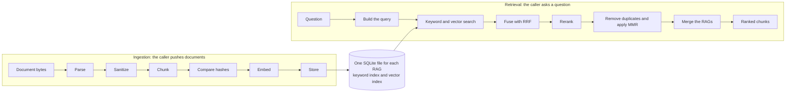
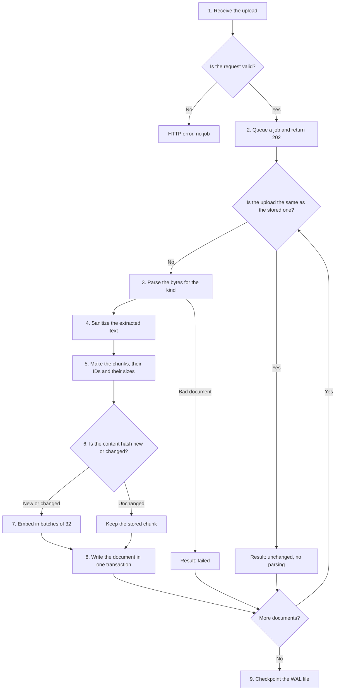
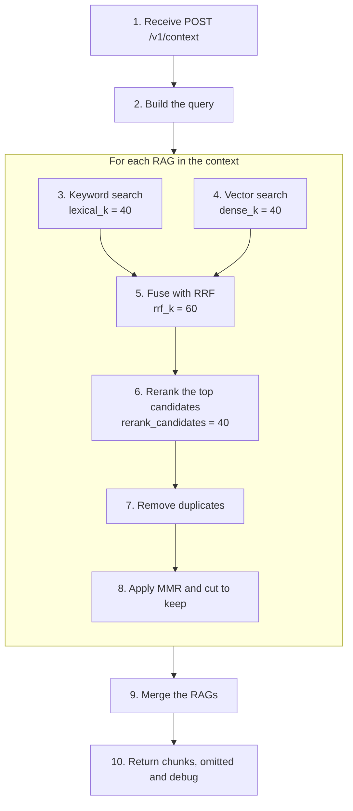
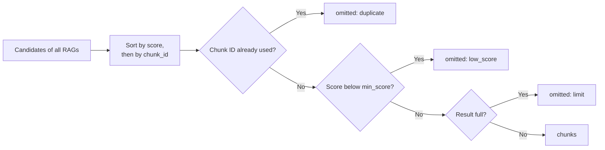

# How xat-rag works

This page explains the full process, step by step. The first part follows a document from upload to index. The second part follows a question from request to ranked chunks. The [architecture](architecture.md) page shows the packages, and the [API reference](api.md) lists the fields and limits.

## The full process



## Terms

| Term | Meaning |
|---|---|
| RAG | One named index, with one SQLite file. Its RAG recipe gives its source kinds, its models and its search values. |
| Context | A named group of RAGs that one question searches. A context recipe defines it. |
| Document | One file that the caller sends, with a `doc_id`. |
| Section | One structural unit of a document that a parser finds, such as the text under a heading. |
| Chunk | One part of a document, with a stable `chunk_id`. A search returns chunks. |
| Candidate | A chunk that a search found, before the final result. |
| Span | The lines, pages, blocks or sheet rows of the document that hold a chunk. |

## Ingestion

Ingestion turns document bytes into searchable chunks. It runs in the background, because a large batch can take minutes on a CPU.



### Step 1: Receive the upload

The caller sends `PUT /v1/rags/{rag}/documents` with a multipart body. The service checks the `Host` and `Origin` headers, the size of the request and the `documents` list. Each document must use a source kind that the RAG has in its recipe. The bytes stay in memory, and they never go to a temporary file.

### Step 2: Queue the job

The service returns 202 and a `job_id` at once. The caller reads the progress with `GET /v1/jobs/{job_id}`.

Each RAG has one worker thread. Jobs of one RAG run in order, and jobs of different RAGs run in parallel. SQLite runs in WAL mode, so questions continue during ingestion. Queued upload bytes can total 256 MiB. More uploads get 503.

### Step 3: Parse

A parser reads the bytes and returns sections. No parser opens a path or a URL.

#### Skip an unchanged upload

Before the parse, xat-rag compares the upload with the stored upload of the same `doc_id`. The check applies to Markdown, text, PDF, DOCX, HTML and Excel. Diff, JIRA and prompt files are always parsed. The check covers these parts of the upload:

- The bytes.
- The `uri`, `title`, `version` and `metadata` fields.
- The chunker version.

If all parts match, the result is `unchanged`, and xat-rag does not parse the file.

#### Find the structure

| Kind | How the parser finds the structure |
|---|---|
| Markdown | Headings give the heading path. |
| Text | The whole document is one section. Its paragraphs are the places where a large section splits. |
| Diff | Each hunk of each file is one section. Binary files are skipped, with a note. |
| JIRA | The summary and description are one section. Each comment is one section, and its parent is the description. |
| Prompt | The whole file is one section. |
| PDF | Headings that the layout model finds give the heading path. A PDF with no heading is one section. |
| DOCX | Heading styles give the heading path. Tables keep their rows. |
| HTML | Headings give the heading path. Navigation and page footers are removed. |
| Excel (`xlsx`) | Each sheet is one section, and the sheet name is its heading. A sheet with no table gives no section. |

#### Read PDF, DOCX, HTML and Excel files

These files go through Docling. Docling finds the typed blocks of the file, such as headings and tables. xat-rag renders these blocks as one Markdown form, and the sections come from this form. xat-rag does not use the Markdown export of Docling, because that export has no source positions.

Page headers and footers are removed. A PDF section can start in the middle of a page, and it can cross pages. The pages of a PDF are only source positions.

These rules apply only to PDF files:

- PDF has no OCR. xat-rag indexes only the pages that have at least `min_page_chars` non-space characters of text. The result of the document lists the skipped pages.
- A PDF with an empty password is indexed. Other encrypted PDF files are refused with the reason `encrypted`.
- The parser needs the layout models in the models folder. The service checks them at start, when a RAG has a `pdf` source.

#### Time limits and bad files

One binary parse runs at a time in the process. Each document has a deadline of 60 seconds. For a PDF, the deadline is 2 seconds for each page, if that is longer. The parsers check the deadline between steps.

The [limits](api.md#limits) protect the service against bad files. A document that passes a limit gets a `failed` result, and the other documents continue.

### Step 4: Sanitize

Sanitizing runs on the extracted text, before chunking. Thus, the spans and the hashes come from the same text that xat-rag stores. Sanitizing does these changes:

- It removes ANSI codes and control characters, except tab, line feed and carriage return.
- It removes zero-width characters, bidirectional controls, Unicode tag characters and variation selectors.
- It turns NEL and the line and paragraph separators into line feeds.
- It normalizes the text to NFC.

Sanitizing does not make the text safe for a prompt. The app must still escape it.

### Step 5: Chunk

The structural chunker turns sections into chunks. A section that fits the size limits becomes one chunk. A section that is too large is split into pieces, and each piece becomes one chunk.

#### What a chunk holds

Each chunk has a `header` with its heading path, its `text`, its `span` and its `metadata`. All pieces of a section have the header of that section.

For PDF, DOCX, HTML and Excel, the `text` is Markdown. It can hold lists, pipe tables and code fences. A word in the file cannot start a heading or a table, because the Markdown comes from the typed blocks.

#### How the chunker decides the size

A chunk has no target size. The structure of the document sets the size, and two limits set the maximum. Thus, a chunk can be much smaller than the limits.

The chunker makes these decisions for each section:

1. It keeps a section that fits both [size limits](#size-limits) as one chunk.
2. It gives the document a `failed` result if the section is too large and its kind has no split.
3. It [splits a too large section](#split-a-too-large-section) with the rule of the source kind.
4. It ends each piece at a topic change or at the structure, and the limits always apply.
5. It joins a very small piece to the piece before it, if the result fits.

Only `max_chunk_tokens` is a recipe value. The code fixes the other values. The [reasons](#reasons-for-the-size-rules) are after the split rules.

#### Size limits

A chunk must fit two limits:

| Limit | Measured with | Value |
|---|---|---|
| `max_chunk_tokens` of the source | The size ruler, the fixed tokenizer of xat-rag | 350 by default, from 32 to 2000 |
| Embedder input | The tokenizer of the embedder | 510 tokens, of the 512 that the model accepts |

The size limits always win over the split rules below. The header counts against both limits. A "full piece" is the text that fills the room after the header, under the tighter limit.

The chunker records the size of each chunk. The size ruler counts the header and the text together. The API shows this count as `size_tokens`. It has no link to the LLM of the app, so the app must count tokens with the tokenizer of its own LLM.

#### Split a too large section

The source kind sets the split:

| Kind | Split of a too large section |
|---|---|
| Markdown, text, PDF, DOCX, HTML and Excel | The [split at blocks](#split-at-blocks). The embedder can [choose the split points](#choose-the-split-points-by-topic). |
| Diff and JIRA | A recursive split at blank lines, then lines, spaces and characters. |
| Prompt | No split. The document gets a `failed` result. |

A section of the first group that has no blocks uses the recursive split. Pieces do not overlap. The `overlap_share` setting can change this, but it exists only for evaluation.

#### Split at blocks

The chunker first cuts the section into parts. A part is the smallest unit that the split can join again:

| Block | Parts |
|---|---|
| A block that fits one full piece | The whole block is one part. |
| A paragraph or a list item that is too large | Groups of sentences, each up to 25% of a full piece. A long sentence splits at words. One token that is still too large splits at characters. |
| A table that is too large | Groups of rows. Each group repeats the header row. |
| Code that is too large | Groups of lines. |

A table or code part is always a piece of its own. The split never joins it with text or with another table or code part.

The chunker then joins the text parts between the tables and code blocks into pieces. By default, the embedder chooses where the pieces end. The chunker uses only the structure in the three cases below. It then fills each piece with neighbouring parts until the next part does not fit.

- A run of text parts has fewer than four parts.
- The document has more than 20000 text parts in its too large sections. Its result gets the note `semantic_split_unit_limit`.
- The `semantic_split` setting is `False`. This setting exists only for evaluation.

The last piece of a section joins the piece before it, if it is below 10% of a full piece and the result fits. Table and code pieces do not join.

#### Choose the split points by topic

This split puts each cut where the topic changes. It runs only on the too large sections of the kinds that use the split at blocks. A section that fits gets no split and no embedding here. For each run of four or more text parts, the chunker does these steps:

1. It embeds each part, with no header. Tables and code get no embedding.
2. It measures each gap between two neighbouring parts. The similarity is the cosine of the mean vector of up to two parts on each side of the gap.
3. It calculates the depth of each gap. From the gap, it moves left and then right while the similarity rises, and it finds the highest value on each side. The depth is the sum of the two rises.
4. It calculates a threshold, which is the mean of the depths plus 0.5 of their standard deviation. Each gap with a depth at or above the threshold is a cut. If all depths are equal, there are no cuts.
5. It cuts a segment that is still too large at its deepest gap, until each segment fits. If two gaps have the same depth, the earlier gap wins.
6. It joins a segment below 15% of a full piece to the segment before it, if the result fits.

For example, a run of six parts has five gaps. These numbers show only the calculation. Similarities are in thousandths:

| Gap | 1 | 2 | 3 | 4 | 5 |
|---|---|---|---|---|---|
| Similarity | 800 | 780 | 300 | 760 | 790 |
| Depth | 0 | 20 | 990 | 30 | 0 |

The mean depth is 208, and the standard deviation is 391. The threshold is thus 404. Only gap 3 passes it, so the chunker makes one cut between the third and the fourth part.

The split has these costs and limits:

- The split points use the same embedder as the index, and their vectors are not stored. [Step 7](#step-7-embed) embeds the final chunks separately.
- The chunker splits before it compares the hashes. Thus, a changed upload embeds the parts of its too large sections again, also when most chunks do not change.
- The split points have their own deadline, which is 0.25 seconds for each text part and at least 60 seconds. A document that passes it gets a `failed` result with the reason `parse_timeout`.
- The chunker version records the split. It ends with `+sem1-<embedder>`, for example `markdown-v3+blocks1+sem1-bge-small-en-v1.5-...`.

`eval/split_comparison.json` compares the two splits, with `max_chunk_tokens` at 120 and 30 cases for each of PDF, DOCX, HTML and Excel. The final results are the same, with a final MRR of 1.0 and a recall of 1.0. The only differences are for PDF. There, the topic split has a keyword-stage MRR of 0.9611, and the structure-only split has 0.9417. The fused-stage MRR is 1.0 and 0.9833.

#### Reasons for the size rules

| Rule | Reason |
|---|---|
| The embedder limit is 510 tokens. | The embedder gives an error for a document above 512 tokens. Each chunk must thus stay below the input size of the model. |
| Each source has its own `max_chunk_tokens`. | Source kinds are different, so a recipe can set a different maximum for each kind. |
| One fixed tokenizer measures `max_chunk_tokens`. | The same text gets the same size in each app. The size has no link to the LLM of the app. |
| The header counts against the limits. | Each piece holds the header of its section, so the header uses room in each piece. |
| The split follows the structure first. | A block, a table row and a sentence are complete units. A chunk ends inside one of them only when the limits make this necessary. |
| A table group repeats the header row. | Each group of rows must be clear without the other groups. |
| The embedder chooses the split points. | The cuts go where the topic changes. The [comparison](#choose-the-split-points-by-topic) shows a small gain for PDF and no loss for the other kinds. |
| The topic split has a part limit and a deadline. | Each text part needs an embedding, and this takes time on a CPU. |
| Pieces do not overlap. | The final MRR and the recall at 5 are 1.0 with overlap and without overlap, in `eval/split_comparison.json`. |

The evaluation does not compare other values for these settings. They are design values, and no measurement in this repository shows that they are the best values:

- The default `max_chunk_tokens` of 350.
- The sentence groups of 25% of a full piece.
- The join limits of 10% for the last piece and 15% for a topic segment.
- The minimum of four text parts for the topic split.
- The factor of 0.5 in the threshold of the topic split.

To choose a different `max_chunk_tokens`, compare the values with the [evaluation harness](../packages/xat-rag-eval/README.md) on your own documents. A lower value gives more chunks that are smaller. At a high value, the embedder limit can become the tighter limit, so a higher value can have no effect. A change to this value needs a [rebuild](quickstart.md#rebuild-a-rag).

#### Chunk IDs

A chunk ID is `<doc_id>#<anchor>`. The anchor comes from the structure of the document, so an ID stays stable across uploads.

| Source | Anchor | Example chunk ID |
|---|---|---|
| Markdown, DOCX, HTML, PDF and Excel | Heading path. Text before the first heading uses `h`. | `docs:orders.md#h/orders-service/ports-and-health` |
| Text | `t` | `docs:notes.txt#t` |
| Diff | File path and hunk number | `diffs:4f2a9c1.diff#f/src/OrderService.java/hunk/1` |
| JIRA | `desc`, or `comment/<id>` | `jira:PROJ-123.json#comment/10023` |
| Prompt | `prompt` | `prompts:style-guide.md#prompt` |

For an Excel file, the sheet name is the heading. A PDF with no heading uses the anchor `h`, so its IDs look like `docs:manual.pdf#h` and `docs:manual.pdf#h/~s1`.

These rules keep the IDs unique and stable:

- If two sections get the same anchor, the later one gets `~2`, then `~3`.
- A split piece gets the ID `<section id>/~s<N>`.
- An empty section gets no chunk, but it keeps its ID slot. Thus, the IDs of later sections do not change when it gets text.

A document that gives no chunks gets a `failed` result with the reason `invalid`.

### Step 6: Compare the hashes

Each chunk has a `content_hash`, the sha256 of its header and text. xat-rag compares each hash with the store:

- A chunk with the same hash is unchanged, so xat-rag does not embed it again.
- A new or changed chunk goes to the next steps.
- A stored chunk that is no longer in the document is deleted.

Thus, a repeated upload is cheap, and a job that stopped does not repeat finished work.

### Step 7: Embed

`OnnxEmbeddings` runs `bge-small-en-v1.5` on the CPU, in batches of 32. The input is the header and the text of the chunk. Each chunk becomes a vector with 384 dimensions. A document text is never cut at this step. If a text does not fit the model, the embedder raises an error.

### Step 8: Store

`SqliteRagStore` writes each document in one transaction. A failure cannot leave half a document in the index. The transaction updates these parts:

- The document and chunk rows.
- The upload fingerprint, in the `ingest_state` table. A later upload of the same bytes can then return `unchanged`.
- The keyword index, in SQLite FTS5.
- The vector index, in sqlite-vec.

#### Expand code names

Before it inserts text in FTS5, xat-rag expands code names. The full compound stays, and its parts are added:

| Text | Tokens |
|---|---|
| `com.shop.OrderNotFoundException` | `com_shop_ordernotfoundexception`, `com`, `shop`, `ordernotfoundexception`, `order`, `not`, `found`, `exception` |
| `snake_case` | `snake_case`, `snake`, `case` |
| `camelCase` | `camelcase`, `camel`, `case` |
| `PROJ-123` | `proj_123`, `proj`, `123` |
| `4f2a9c1` | `4f2a9c1` |

### Step 9: Finish the job

The service checkpoints the WAL file when a job finishes all its documents. A cancelled job does not checkpoint. Each document has a result with the status `created`, `updated`, `unchanged` or `failed`.

## Retrieval

Retrieval turns a question into a ranked list of chunks. It calls no LLM.



The values in the diagram are the defaults. Each RAG recipe can change them.

Each stage has a time limit in the context recipe. xat-rag checks a limit after its stage ends, and it does not stop a stage in the middle. A stage over its limit gives `stage_timeout_error`.

### Step 1: Receive the request

The caller sends `POST /v1/context` with a context name and a question. The service checks the request and finds the context recipe. At most `XatRag__QueueLimit` requests can wait or run in the pool. More requests get 503. Blocking work runs in a pool of two worker threads.

### Step 2: Build the query

`build_query()` sanitizes the question. Line breaks and tabs become spaces. A question with no text after this step gets 400. The function then makes three texts, because each stage needs a different input.

| Part | Used by | Content |
|---|---|---|
| `lexical_terms` | Keyword search | At most 32 unique terms. Code names stay whole, for example `OrderService.java` or `PROJ-123`. |
| `dense_text` | Vector search | The whole question. The embedder uses only the part that fits its input of 512 tokens. |
| `rerank_text` | Reranker | The first 600 characters. The reranker cuts this query to 256 tokens. |

Thus, put the most important text first in a long question.

### Step 3: Keyword search

`Fts5Retriever` searches the FTS5 index with BM25. It applies the same [code-name expansion](#expand-code-names) to the query terms as ingestion does. Each token is in double quotes and the tokens are joined with `OR`, so that a question cannot use the FTS5 query syntax. This search finds exact terms, such as error codes, file paths, JIRA keys and commit SHAs.

### Step 4: Vector search

`VecRetriever` embeds the dense text, with the query prefix of the model. It then finds the nearest vectors in sqlite-vec. This search finds text that has the same meaning in other words. The query is embedded once for each RAG.

### Step 5: Fuse with RRF

Reciprocal rank fusion (RRF) combines the two lists. It uses only the ranks, because BM25 scores and vector distances are on different scales. A chunk gets this score:

```text
rrf_score = 1 / (rrf_k + keyword_rank) + 1 / (rrf_k + vector_rank)
```

A list that did not find the chunk adds nothing. A chunk that both searches find gets a high score. The top `rerank_candidates` chunks continue.

### Step 6: Rerank

The cross-encoder `ms-marco-MiniLM-L6-v2` reads the question and each candidate together, and it gives a new score. This step is slower, but it is more accurate than the searches. If a pair is longer than 512 tokens, the reranker cuts the end of the chunk text. The `debug` list then shows `rerank_truncated: true`.

A RAG with `reranker = "none"` skips this step, and its score is the RRF score. A rerank score is a raw value of the model. It is not a probability, and it has no fixed range.

### Step 7: Remove duplicates

A candidate is a duplicate when it has the same content hash as a better candidate, or a cosine similarity of 0.95 or more. It goes to `omitted` with the reason `duplicate`.

### Step 8: Apply MMR and cut to `keep`

Maximal marginal relevance (MMR) chooses chunks that are relevant and different from each other. The `mmr_lambda` value sets the balance, and the default is 0.7. A higher value prefers relevance. Each RAG gives at most `keep` chunks to the merge.

A chunk that this step removes is not listed in `omitted`, and it does not come back later.

### Step 9: Merge the RAGs



All RAGs of a context use the same reranker, so their scores are on one scale. A chunk with a score equal to `min_score` stays. Ties are broken by `chunk_id`, so one input gives one order on one platform.

### Step 10: Return the result

The response has three fields:

- `chunks`: the chunks in rank order, each with its `text`, `header`, `source` and `metadata`.
- `omitted`: the candidates that were found but not returned, with the reason.
- `debug`: the ranks and scores of each candidate, when the request asks for them.

xat-rag stops here. The app [fits the chunks to its LLM](quickstart.md#6-what-your-app-must-do), builds the prompt and checks the citations.

## A worked example

This example uses the document of the [quickstart](quickstart.md#upload-a-document). The numbers come from a real run.

**Ingestion.** The Markdown parser finds two sections under the title `Orders service`. The job result has `chunks: 2` and `embedded: 2`. An upload of the same bytes embeds nothing again.

| Chunk ID | Header | Lines |
|---|---|---|
| `docs:orders.md#h/orders-service/ports-and-health` | `Orders service > Ports and health` | 5 to 6 |
| `docs:orders.md#h/orders-service/database-timeouts` | `Orders service > Database timeouts` | 10 |

**Retrieval.** The question is "Which port does the orders service use?", and the context is `ask-docs`.

| Chunk | Keyword rank | Vector rank | RRF score | Rerank score |
|---|---|---|---|---|
| `ports-and-health` | 1 | 1 | 1/61 + 1/61 = 0.0328 | 8.02 |
| `database-timeouts` | 2 | 2 | 1/62 + 1/62 = 0.0323 | -0.25 |

The RRF scores are almost equal, because the document has only two chunks. The reranker separates them clearly. Both scores are above the `min_score` of -5, so both chunks pass. With `"chunks": 1`, the second chunk goes to `omitted` with the reason `limit`.
