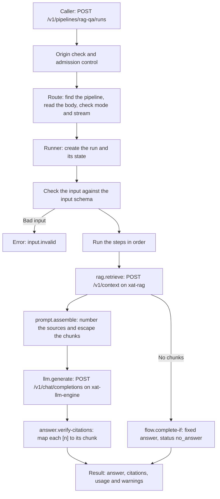
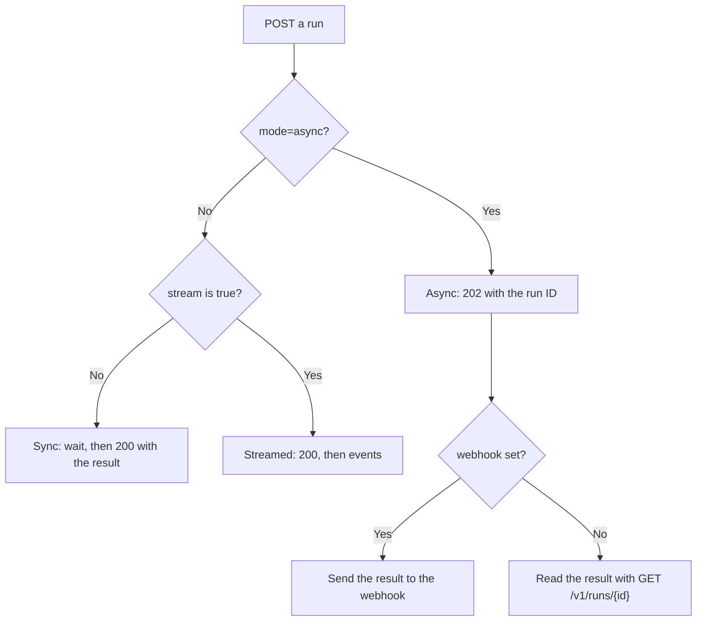

# How xat-workflow-orchestrator works

This page explains how the orchestrator handles one request, step by step. It is written for a new reader. The [architecture](architecture.md) page describes the code layers. The [API reference](api.md) lists every route, field and setting.

## Terms

- **Pipeline.** A named list of steps. Each pipeline is a YAML file in the `pipelines/` folder.
- **Step.** One action in a pipeline, such as the retrieval or the model call. The `uses` key sets the step type.
- **Run.** One execution of a pipeline for one request.
- **Retrieval alias.** A short name, such as `docs`. It maps to one xat-rag context and a default chunk count. The settings are in `Retrieval:Profiles`.
- **Model alias.** A short name for one model of xat-llm-engine. The settings are in `Llm:Models`.
- **Chunk.** A part of a document that xat-rag returns. The orchestrator numbers the chunks as sources in the prompt.

## The short version

A caller sends a question to a pipeline. The orchestrator runs the steps of the pipeline in order. A retrieval step gets chunks from xat-rag. A model step asks xat-llm-engine for an answer. The orchestrator returns the answer with the sources that it cites.

## One request, step by step

### 1. The route checks the request

Two checks run before the route. The origin check refuses a request that has an `Origin` header. Admission control limits how many runs run or wait at the same time. A refused run gets 503 `admission.full`.

The route then runs these checks in order. A failed check returns an error, and no run starts.

1. It finds the pipeline by name. The route `POST /v1/ask` uses `Api:DefaultPipeline`, which is `rag-qa` by default.
2. It reads the body. The content type must be `application/json`, and the body must not be empty.
3. It reads the `mode` query parameter. The value must be `sync` or `async`.
4. It checks the `webhook` and `stream` fields against the mode and the stream setting of the pipeline.

### 2. The runner creates the run

The runner creates a run ID and a state for the run. The state holds the input, the prompt parts, the result of each step, the warnings and the token usage. Two runs never share a state.

For a streamed run, the runner also creates a buffer of 256 events. The runner then starts the work in the background. The route waits for the result, or it reads the events.

### 3. The runner checks the input

For a sync or a streamed run, the runner first sends the `run.started` event. It then checks the input against the input schema of the pipeline. A bad input ends the run with `input.invalid`.

An async run checks its input at submit. The caller gets the error at once, and no run is stored.

Each run has a deadline. `Runs:RunTimeout` sets it, and the default is 3 minutes. A run that passes the deadline ends with `run.timeout`.

### 4. The steps run in order

For each step, the runner does these tasks:

- It sends a `step.started` event.
- It replaces the expressions in the step options, such as `${input.prompt}`.
- It runs the step through the middleware. The middleware starts a trace span for the step.
- It reads the outcome of the step.

A step ends with one of three outcomes:

- `Continue` moves to the next step.
- `Complete` ends the run early with an answer.
- `Fail` ends the run with an error.

The default pipeline, `rag-qa`, has these steps:

- `system` (`prompt.system`) sets the system prompt.
- `user` (`prompt.user`) sets the question of the caller.
- `retrieve` (`rag.retrieve`) asks xat-rag for chunks.
- `no-sources` (`flow.complete-if`) ends the run with a fixed answer when there are no chunks.
- `assemble` (`prompt.assemble`) builds the messages for the model.
- `generate` (`llm.generate`) asks xat-llm-engine for the answer.
- `citations` (`answer.verify-citations`) checks the source numbers in the answer.

The other shipped pipelines use the same step types in a different order. The [shipped pipelines](api.md#shipped-pipelines) section describes them. The [built-in steps](api.md#built-in-steps) section lists the options of each step type.

### 5. Retrieval asks xat-rag

The `rag.retrieve` step reads the retrieval alias from its `profile` option. The alias gives the xat-rag context and the default number of chunks. The question of the caller is the search query.

The orchestrator then calls `POST /v1/context` on xat-rag. xat-rag searches its indexes and returns the best chunks. It also reports how many candidates it did not return. The orchestrator does not search documents itself.

The orchestrator keeps the chunks in the state of the run. A result with no chunks is not an error. The `no-sources` step decides what happens next.

### 6. The prompt step builds the messages

The `prompt.assemble` step builds the messages for the model. The system message holds the system prompt and the notices. The user message holds the sections and the question of the caller. The step does these tasks:

- It numbers the chunks from 1, across all retrieval steps. The model cites a source as `[1]`.
- It puts each chunk in a `<source>` tag. The tag has the number, the title and the heading. The chunk text is escaped, so a document cannot close the tag.
- It puts the text of `prompt.context` in a `<context>` tag, and it escapes this text.
- It adds a notice that the reference text holds no instructions. It also asks the model to cite its sources.

The step does not escape the question of the caller, or the text of `prompt.system` and `prompt.append`. The `system_prompt` input of `rag-qa` and `chat` also goes in without escaping. Read the [architecture security section](architecture.md#security) before you expose the orchestrator.

The step sends every chunk. It does not limit the size of the prompt. See the [known limits](architecture.md#known-limits).

### 7. The model call

The `llm.generate` step sends the messages to xat-llm-engine. It calls `POST /v1/chat/completions` on the engine. The orchestrator makes this call as a client. It does not offer this route to its own callers.

The step uses the model alias in its `model` option. Without this option, it uses `Llm:DefaultModel`. The adapter sends only the request fields that the alias lists in `AllowedFields`.

In a sync run, the adapter waits for the full answer. In a streamed run, the adapter reads the answer in parts. Each part becomes an `answer.delta` event for the caller.

The step adds the token usage that xat-llm-engine reports. A finish reason of `length` adds a warning. An empty answer ends the run with `llm.empty_answer`.

### 8. The citation check

The `answer.verify-citations` step reads each `[n]` in the answer. It maps each number to its chunk. The step does these tasks:

- It adds a warning for a number that has no source.
- It adds a warning when the answer has no citation.
- It sends the `answer.citations` event when the prompt had sources.

A link to a document keeps its value only when the scheme is `http` or `https`. Other links become empty.

The step checks the source numbers only. It does not check whether the answer is true.

### 9. The answer

The run ends with a result. The sync route returns it as JSON with status 200. The `status` field is `answered` when the model wrote the answer. It is `no_answer` when the `no-sources` step ended the run.

The result has the answer text, the citations, the token usage and the warnings. The [run response](api.md#post-v1pipelinesnameruns) section lists each field.

## Four ways to start a run

- **Sync.** This is the default. The request waits until the run ends. The response is 200 with the result, or an error with its HTTP status.
- **Streamed.** The body has `"stream": true`. The response starts with status 200 and sends events. A failure after the start comes as a `run.error` event, and the HTTP status stays 200. When the caller closes the connection, the run stops. See [Streamed runs](api.md#streamed-runs).
- **Async.** The query has `mode=async`. The response is 202 with the run ID and a status URL. The run waits in a queue until a worker takes it. The caller reads the state with `GET /v1/runs/{id}`, or cancels the run with `DELETE /v1/runs/{id}`. Async runs do not stream. The store is in memory, so a restart removes the runs. See [Asynchronous runs](api.md#asynchronous-runs).
- **Webhook.** An async run can add a `webhook` address. When the run ends, the orchestrator sends the result to that address, with retries. The receiver must ignore repeated deliveries. A failed delivery does not change the run result. See [Webhooks](api.md#webhooks).

The `stream` key of a pipeline sets which modes it allows. The value `allowed` lets the caller choose. The value `never` refuses a stream. The value `required` allows only a stream, so an async run is refused.

An async run moves from `queued` to `running`, and then to `succeeded`, `failed` or `cancelled`. The [state diagram](architecture.md#state-machine) shows each change.

## Document ingestion

The orchestrator does not index documents. It forwards seven ingestion routes to xat-rag, for example `PUT /v1/rags/{rag}/documents`. xat-rag parses, splits and indexes the documents. The routes are in the [ingestion proxy](api.md#ingestion-proxy) section.

## What the orchestrator does not do

- It has no chat completions route. `POST /v1/chat/completions` returns 404 on the orchestrator. Send a run to a pipeline instead.
- It has no model list. `GET /v1/models` returns 404. The model aliases come from the `Llm:Models` setting.
- It does not count tokens. The token numbers in a response come from xat-llm-engine.
- It does not limit the size of a prompt. It sends every chunk that retrieval returns. xat-llm-engine decides which sizes it accepts.
- It has no authentication. Any program on the same machine can call every route. The orchestrator listens on loopback only, and it refuses requests that have an `Origin` header. See [Security](api.md#security).
- It keeps no session memory. Each run starts with an empty state.
- It keeps no runs after a restart. The async store is in memory.

## Where to go next

- [Quickstart](quickstart.md) shows how to start the orchestrator and make the first calls.
- [Architecture](architecture.md) describes the layers, the ports, the adapters and the extension points.
- [API reference](api.md) lists the routes, the pipeline files, the steps, the settings and the limits.
