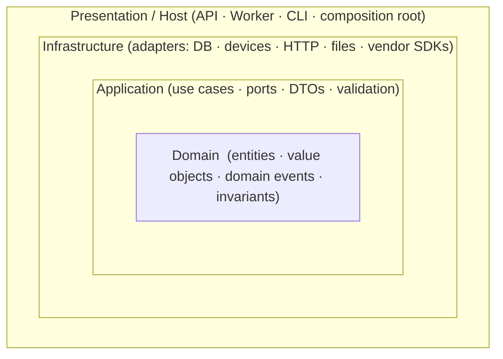
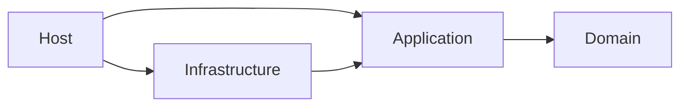

# Clean Architecture

This page describes how we apply Clean Architecture (also known as Ports and Adapters, Hexagonal, or Onion) in .NET 10. [Architecture Principles](./architecture-principles.md) and [SOLID › DIP](./solid-principles.md#dependency-inversion-principle-dip) cover the principles.

---

## The dependency rule

> Source-code dependencies point **only inward**. Nothing in an inner circle knows anything about an outer circle.





- **Domain** depends on nothing (only the BCL).
- **Application** depends on Domain. It defines **ports** (interfaces) for everything it needs from the outside world.
- **Infrastructure** depends on Application (and Domain), and **implements** the ports as adapters.
- **Host** references everything, but only to **compose** the application: DI registration, configuration, and startup.

Data crosses boundaries as simple structures (DTOs, records). Inner layers never receive outer-layer types such as `HttpContext`, `DbContext`, `SerialPort`, or vendor classes.

---

## Layers and responsibilities

### Domain

**Contains:** entities (identity and lifecycle), value objects (immutable and validated), domain events, domain services (logic that does not belong to one entity), domain errors, and enumerations.

**Rules**
- Pure C#, with no I/O, no framework references, no logging, and no DI attributes.
- **Enforce invariants** in constructors and methods. An object that exists is valid.
- Use strongly typed IDs and value objects instead of primitives.

```csharp
public readonly record struct DeviceId(Guid Value);

public sealed record Offset
{
    public int Millimetres { get; }
    private Offset(int mm) => Millimetres = mm;

    public static Result<Offset> Create(int mm) =>
        mm is >= 0 and <= 300 ? Result<Offset>.Ok(new Offset(mm))
                              : Result<Offset>.Fail("Offset must be between 0 and 300 mm.");
}
```

### Application

**Contains:** use cases (commands and queries with handlers), **ports** (interfaces for persistence, devices, clocks, messaging, and notifications), request/response DTOs, validation, orchestration, and transaction boundaries.

**Rules**
- One use case per class, organised **by feature** (`Features/Calibrate/`, `Features/Stamp/`), not by technical type.
- Depends only on Domain and on abstraction packages (`Microsoft.Extensions.Logging.Abstractions`, `Microsoft.Extensions.Options`).
- Give ports the shape of **what the use case needs**, in domain language, not the shape of what a vendor API offers ([ISP](./solid-principles.md#interface-segregation-principle-isp)).

### Infrastructure

**Contains:** adapters that implement ports: database access, serial/USB/network device drivers, native interop, HTTP clients, file storage, message brokers, and resilience policies.

**Rules**
- Adapter classes are `internal sealed`. Other code can reach them only through the ports they implement and a registration extension method.
- Translate external types and errors into Application/Domain types at the edge ([anti-corruption layer](./architecture-principles.md#boundaries-and-contracts)).
- All retry, timeout, and reconnection logic lives here.

### Presentation / Host

**Contains:** the entry point (ASP.NET Core minimal APIs, a worker service, a CLI, a desktop UI), endpoint/controller definitions, request-to-DTO mapping, the global exception handler, and the **composition root**.

**Rules**
- Thin. It translates an inbound request into a use-case call and the result into a response.
- No business rules.

---

## Reference solution layout

```
<Product>.slnx
Directory.Build.props
Directory.Packages.props
global.json
.editorconfig
src/
  <Product>.Domain/                 # no project references
  <Product>.Application/            # → Domain
    Abstractions/                   # ports: IDeviceClient, IClock, IUnitOfWork, ...
    Features/
      <FeatureA>/                   # Command/Query + Handler + Validator + DTOs
      <FeatureB>/
    DependencyInjection.cs          # AddApplication()
  <Product>.Infrastructure/         # → Application
    <Integration>/                  # one folder per adapter (Devices/, Persistence/, Http/)
    DependencyInjection.cs          # AddInfrastructure()
  <Product>.Host/                   # → Application, Infrastructure (Worker, API, or CLI)
    Program.cs                      # composition root
tests/
  <Product>.Domain.Tests/
  <Product>.Application.Tests/      # use cases with fake ports
  <Product>.Infrastructure.Tests/   # adapters against real or containerised dependencies
  <Product>.Architecture.Tests/     # dependency rules
```

**Project-reference rules**

| Project | May reference |
|---------|---------------|
| Domain | Nothing |
| Application | Domain |
| Infrastructure | Application, Domain |
| Host | Application, Infrastructure |
| Tests | The project under test, plus test utilities |

For an **SDK/library** product, the "Host" is the consumer's application. Ship the public API from the Application layer (or a thin facade over it). Ship adapters as Infrastructure packages, which the consumer registers with `AddXyz()`.

---

## Ports and adapters in practice

```csharp
// Application/Abstractions/IDeviceClient.cs: the port, in domain terms
public interface IDeviceClient
{
    Task<Result<DeviceStatus>> GetStatusAsync(CancellationToken ct);
    Task<Result> MoveToAsync(Offset offset, CancellationToken ct);
}
```

```csharp
// Infrastructure/Devices/SerialDeviceClient.cs: the adapter
internal sealed class SerialDeviceClient(
    ISerialTransport transport,
    ILogger<SerialDeviceClient> logger) : IDeviceClient
{
    public async Task<Result> MoveToAsync(Offset offset, CancellationToken ct)
    {
        var reply = await transport.SendAsync(Frames.Move(offset.Millimetres), ct);
        return Frames.ToResult(reply);   // protocol details stay here
    }

    // ...
}
```

Application owns the port, and Infrastructure contains the adapter. To change hardware, transport, or vendor, write a new adapter. **No use case changes.**

---

## Use cases

Each use case is one handler with an explicit input and output:

```csharp
// Application/Features/Calibrate/CalibrateCommand.cs
public sealed record CalibrateCommand(DeviceId DeviceId, int OffsetMm);

public sealed class CalibrateHandler(IDeviceClient device, ICalibrationStore store)
{
    public async Task<Result> HandleAsync(CalibrateCommand command, CancellationToken ct)
    {
        var offset = Offset.Create(command.OffsetMm);
        if (!offset.IsSuccess) return Result.Fail(offset.Error!);

        var moved = await device.MoveToAsync(offset.Value!, ct);
        if (!moved.IsSuccess) return moved;

        await store.SaveAsync(command.DeviceId, offset.Value!, ct);
        return Result.Ok();
    }
}
```

**Guidelines**
- Handlers orchestrate. Domain types decide.
- Return `Result`/`Result<T>` for expected failures. Let unexpected exceptions go to the global handler of the host.
- Accept and pass `CancellationToken` everywhere.
- A mediator library is **optional**. A simple `ICommandHandler<TCommand, TResult>` interface registered in DI is often enough.

### Cross-cutting concerns via decorators

```csharp
public interface ICommandHandler<in TCommand, TResult>
{
    Task<TResult> HandleAsync(TCommand command, CancellationToken ct);
}

internal sealed class LoggingHandler<TCommand, TResult>(
    ICommandHandler<TCommand, TResult> inner,
    ILogger<LoggingHandler<TCommand, TResult>> logger) : ICommandHandler<TCommand, TResult>
{
    public async Task<TResult> HandleAsync(TCommand command, CancellationToken ct)
    {
        using var _ = logger.BeginScope("{Command}", typeof(TCommand).Name);
        logger.LogInformation("Handling {Command}", typeof(TCommand).Name);
        return await inner.HandleAsync(command, ct);
    }
}
```

Apply validation, logging, metrics, and transactions this way, once, and not inside every handler.

---

## Composition root and registration

Each layer exposes one registration method. The host calls them in one place:

```csharp
// Infrastructure/DependencyInjection.cs
public static class DependencyInjection
{
    public static IServiceCollection AddInfrastructure(this IServiceCollection services, IConfiguration config)
    {
        services.AddOptions<DeviceOptions>()
                .Bind(config.GetSection(DeviceOptions.SectionName))
                .ValidateDataAnnotations()
                .ValidateOnStart();

        services.AddSingleton<ISerialTransport, SerialTransport>();
        services.AddSingleton<IDeviceClient, SerialDeviceClient>();
        services.AddSingleton<ICalibrationStore, FileCalibrationStore>();
        return services;
    }
}
```

```csharp
// Host/Program.cs
var builder = Host.CreateApplicationBuilder(args);

builder.Services
    .AddApplication()
    .AddInfrastructure(builder.Configuration);

builder.Services.AddHostedService<StatusPoller>();

await builder.Build().RunAsync();
```

[.NET › Dependency injection](./dotnet-best-practices.md#dependency-injection) covers lifetimes and container rules.

---

## Testing strategy per layer

| Layer | What to test | How |
|-------|--------------|-----|
| Domain | Invariants, state transitions, calculations | Plain unit tests, no fakes needed |
| Application | Use-case behaviour, orchestration, error paths | Unit tests with **in-memory fakes** of ports, `FakeTimeProvider` |
| Infrastructure | Adapters actually work with the real dependency | Integration tests against a real or containerised dependency, or a device simulator; contract tests shared with fakes |
| Host | Wiring, configuration, endpoints | A few smoke tests (`WebApplicationFactory`, host builds and starts) |
| Architecture | The dependency rule | NetArchTest / ArchUnitNET |

```csharp
[Fact]
public void Application_depends_only_on_domain()
{
    var result = Types.InAssembly(typeof(CalibrateHandler).Assembly)
        .ShouldNot()
        .HaveDependencyOnAny("MyProduct.Infrastructure", "MyProduct.Host")
        .GetResult();

    Assert.True(result.IsSuccessful);
}
```

**Tip:** write one **contract test suite** for each port. Run it against both the fake and the real adapter. This proves that the fake behaves like the real adapter ([LSP](./solid-principles.md#liskov-substitution-principle-lsp)).

---

## Pragmatism: avoiding ceremony

Clean Architecture is useful when there are real business rules and several external integrations. It **does not** require:

- **An interface for every class.** Abstract only ports (I/O, hardware, time, external systems). Domain types and handlers can be concrete.
- **Pass-through layers.** If a handler only forwards a call, ask whether the use case is necessary. For very simple queries, call the domain directly from the host.
- **Separate DTOs for identical shapes** inside the same layer.
- **Four projects for a tiny tool.** A small component can use **folders** (`Domain/`, `Application/`, `Infrastructure/`) in one project, and architecture tests can enforce the rules. Split it into projects when the component grows or when reuse makes this necessary.
- **A generic repository** over an ORM that already provides one.

If you are not sure, apply [KISS and YAGNI](./solid-principles.md#related-principles). You must always obey the dependency rule. All other parts are optional support.

---

## Review checklist

- [ ] Domain has no references to Application, Infrastructure, frameworks, or I/O.
- [ ] Application defines the ports it needs in domain language and references no Infrastructure types.
- [ ] Adapters are `internal sealed`, translate external types and errors, and own resilience logic.
- [ ] The host is thin: composition, configuration, and mapping only.
- [ ] Each use case has its place by feature, takes a `CancellationToken`, and returns a result for expected failures.
- [ ] Cross-cutting concerns use decorators or pipeline behaviours, not copy-paste.
- [ ] Each layer has the right kind of tests, and the architecture tests pass.
- [ ] No unnecessary structure: no interface without a reason, and no pass-through layers.
