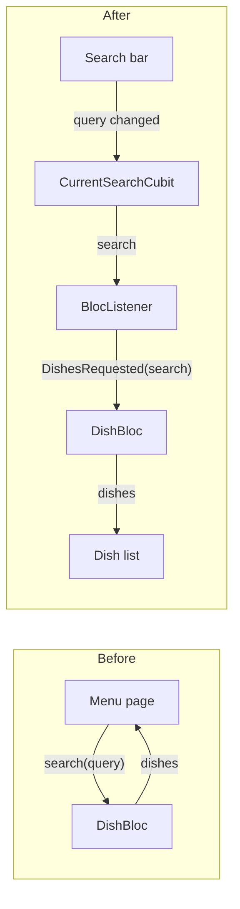

# BLoC Best Practices

How we manage state with the BLoC pattern and the [`bloc`](https://bloclibrary.dev) / `flutter_bloc` packages, and how we structure an application around it.

Much of this page uses a thesis by Sebastian Faust: *Using Google's Flutter Framework for the Development of a Large-Scale Reference Application* (TH Köln with Capgemini, 2020). This page calls it **"the thesis"**. The thesis rebuilt the *My Thai Star* restaurant app of Capgemini in Flutter. It includes an interview with Felix Angelov, the author of the `bloc` package, about BLoC in the large Flutter app of BMW. See [Sources](#sources).

The thesis used an early version of the `bloc` package (`mapEventToState`, `yield`, `dispatch`, `currentState`). Its *ideas* are still correct, but its *code* no longer compiles. Every example here uses the current API (`on<Event>`, `emit`, `add`, `state`). Where current guidance disagrees with the thesis, the section says so and explains why.

How BLoC fits into the overall layering (and into feature packages) is in [Flutter Architecture](./flutter-architecture.md).

---

## State management is not architecture

The thesis makes a distinction that is easy to blur (section 4.1.1):

- **State management** is how an app stores data that changes over time, changes it, and sends it to the widgets that show it.
- **Architecture** is the overall set of rules the app follows: which layers exist, who may depend on whom, where code lives.

Every architecture needs some state management, but picking a state management library does not give you an architecture. BLoC is popular for large apps because it comes with strong rules that make a layered architecture easy to follow.

---

## Why BLoC

The thesis compared the three most popular options at the time:

| Option | Strengths | Weaknesses |
|--------|-----------|------------|
| **Provider** | Simple, easy to learn, endorsed by the Flutter team | No architecture of its own; does not scale well on its own for large apps |
| **Redux** | Strict rules, predictable state changes | One global store that grows very large; lots of boilerplate; steep learning curve |
| **BLoC** | Clear rules, predictable state changes, business logic separated from UI, enables a layered architecture (UI → BLoC → repository → data) | Learning curve |

Angelov's team at BMW started with Redux for global state and BLoC for local state, then moved to BLoC only. They had two reasons. New developers learned BLoC more easily. Also, **one bloc per use case**, and not one large store for everything, made the app easier to split into modules.

Implementing the pattern gives the app these properties (thesis 4.1.3.1):

1. Business logic is easy to find; it is all in blocs.
2. Business logic is independent of the UI.
3. Business logic is easy to test.
4. Widgets rebuild only when the state they depend on changes.
5. State changes are predictable and happen in only one place.

---

## The rules of the BLoC pattern

Paolo Soares, who designed the pattern at Google, defined eight rules. The thesis uses them as the basis of its architecture. Here they are with how they apply today.

**Rules for blocs**

| # | Original rule | Today |
|---|---------------|-------|
| 1 | Inputs and outputs are simple sinks and streams only. | The `bloc` package enforces this: events go in with `add`, states come out of `stream`. A `Cubit` uses methods as inputs instead of events. |
| 2 | All dependencies must be injectable and platform-agnostic. | Inject repositories through the constructor. No `BuildContext`, no Flutter imports, no plugins inside a bloc. |
| 3 | No platform branching. | No `Platform.isIOS` inside blocs. |
| 4 | The implementation can be anything, as long as 1–3 hold. | Still true. |

**Rules for widgets**

| # | Original rule | Today |
|---|---------------|-------|
| 1 | Each "complex enough" widget has a related bloc. | In practice: **one bloc per feature**, where a feature is "one piece of value given to the customer" (Angelov). Simple widgets do not need their own. |
| 2 | Widgets do not format the inputs they send to the bloc. | Send raw user input (`'4'` from a text field); the bloc parses and validates it. |
| 3 | Widgets show the bloc's state with as little formatting as possible. | Locale-aware display formatting (dates, currency) is a presentation concern and may live in the widget or a presentation helper. Business rules may not. See [Models](#models). |
| 4 | Any platform branching depends on a single boolean from a bloc. | Keep platform decisions in one place (a bloc state or an injected service), never scattered through widgets. |

---

## Bloc or Cubit

The `bloc` package offers two classes. Both hold state and emit new states; they differ in how input arrives.

| | `Cubit` | `Bloc` |
|---|---------|--------|
| Input | Method calls: `cubit.increment()` | Event objects: `bloc.add(Incremented())` |
| Boilerplate | Small | More (event classes) |
| Traceability | You see state changes | You see the event **and** the state change (`onTransition`) |
| Event timing control | No | Yes: debounce, drop, restart, queue ([Concurrency](#event-concurrency)) |

**Do**
- Start with a **Cubit**. Change to a **Bloc** when you need event transformers (search during typing, double taps that the app ignores). Also change when *the event that caused a change* is important for debugging or analytics.

---

## Designing blocs

The hardest part of the architecture, according to the thesis, is deciding how big each bloc should be and what it owns (section 4.2.2). The process the thesis and Angelov recommend:

1. Implement one **feature** as one bloc.
2. If the bloc becomes awkward to work with, **split it in two**.
3. Repeat step 2.

**Do**
- **Draw the state machine before writing code** (Angelov's tip): the states, and which events move between them. If the diagram is hard to draw, the bloc does too much.
- Prefer **small, focused blocs**. They are easier to test and to reuse.
- Split when a bloc holds two kinds of state that change for different reasons.

**Do not**
- Create an **"AppBloc"** that handles everything. Angelov limited each bloc to one input and one output stream precisely to make it obvious when a bloc does too much.
- Create a bloc for a widget that only shows data or has purely visual state.

### Example from the thesis: splitting the menu

The thesis started the *digital menu* with one `DishBloc`: the UI sent a query, the bloc fetched dishes. Later the app had to remember the query when the user left the page. A `lastQuery` field on every dish state was not a clean solution, because every widget then had to check its value. The real problem was that the bloc did two jobs:

- **Holding the current search** (what the user typed, filters, sort order).
- **Fetching dishes** for a search.

The solution was a `CurrentSearchBloc` and a smaller `DishBloc`. Now the search bar talks only to the search bloc, and the "Apply filters" button talks only to the dish bloc. The "fetch" event no longer has to carry the query.



In the thesis, `DishBloc` received `CurrentSearchBloc` in its constructor and read its state directly. We wire them differently; see [Communication between blocs](#communication-between-blocs).

---

## Events

**Do**
- Model events as a **sealed class** with `final` subclasses, so handlers are type-checked.
- Name events in the **past tense**, after what happened, not what the bloc should do: `DishSearchSubmitted`, `ExtraToggled`, `BookingFormSubmitted`. (Angelov said BMW's team ran into problems until they adopted naming conventions; these follow the `bloc` library's.)
- Carry only the data needed to handle the event.
- Keep events immutable.

```dart
sealed class DishEvent {
  const DishEvent();
}

final class DishesRequested extends DishEvent {
  const DishesRequested(this.search);
  final Search search;
}

final class DishesRefreshed extends DishEvent {
  const DishesRefreshed();
}
```

**Do not**
- Name events like commands (`FetchDishes`, `LoadData`). An event says what happened; the bloc decides what to do about it.

---

## States

**Do**
- Make states **immutable** and give them **value equality** (`Equatable`, `freezed`, or records; see [Dart › Immutability and equality](./dart-best-practices.md#immutability-and-equality)).
- Pick one of two shapes per bloc:

  | Shape | Use when | Example |
  |-------|----------|---------|
  | **Sealed subclasses**, one per state | States carry different data and cannot co-exist (no dishes while loading the first page) | `DishInitial`, `DishLoadInProgress`, `DishLoadSuccess(dishes)`, `DishLoadFailure(message)` |
  | **One class with a `status` enum** and `copyWith` | Data must survive state changes (keep the old list visible while refreshing; keep form input while submitting) | `DishState(status: DishStatus.loading, dishes: previous)` |

- Name state subclasses `<Subject><Action><Status>`, where status is `Initial`, `InProgress`, `Success`, or `Failure`. Angelov noted that most of BMW's blocs ended up with these four states.
- Use a plain `enum` as the state when it really is that simple (the thesis's interview: "enums as states are nice when states are very simple").

```dart
sealed class DishState extends Equatable {
  const DishState();
  @override
  List<Object?> get props => [];
}

final class DishInitial extends DishState {
  const DishInitial();
}

final class DishLoadInProgress extends DishState {
  const DishLoadInProgress();
}

final class DishLoadSuccess extends DishState {
  const DishLoadSuccess(this.dishes);
  final List<Dish> dishes;
  @override
  List<Object?> get props => [dishes];
}

final class DishLoadFailure extends DishState {
  const DishLoadFailure(this.message);
  final String message;
  @override
  List<Object?> get props => [message];
}
```

**Do not**
- Mutate the current state and emit it again. The bloc only notifies listeners when the new state is **not equal** to the old one, so the UI will not update (thesis section 4.4).

```dart
// ❌ Same list instance, mutated: equal to the previous state, nothing rebuilds
state.items.add(dish);
emit(state);

// ✅ New list, new state
emit(state.copyWith(items: [...state.items, dish]));
```

- Put `BuildContext`, widgets, controllers, or `Exception` objects in states. Store what the UI needs to render (a message key, an error type).

---

## Implementing a bloc

The thesis's `DishBloc`, rewritten for the current API, depending on a repository interface instead of the thesis's generic `Service<Input, Output>`:

```dart
class DishBloc extends Bloc<DishEvent, DishState> {
  DishBloc({required DishRepository dishRepository})
      : _dishRepository = dishRepository,
        super(const DishInitial()) {
    on<DishesRequested>(_onRequested, transformer: restartable());
  }

  final DishRepository _dishRepository;

  Future<void> _onRequested(DishesRequested event, Emitter<DishState> emit) async {
    emit(const DishLoadInProgress());
    try {
      final dishes = await _dishRepository.search(event.search);
      emit(DishLoadSuccess(dishes));
    } on DishSearchException catch (e) {
      emit(DishLoadFailure(e.message));
    }
  }
}
```

**Do**
- Register one handler per event type with `on<E>` in the constructor.
- Await all async work inside the handler. The bloc considers the event handled when the returned `Future` completes.
- Use `emit.forEach` / `emit.onEach` to change a repository stream into states. Flutter cancels the subscription automatically when the bloc closes or the handler restarts:

```dart
on<OrderWatched>((event, emit) => emit.forEach<Order>(
      _orderRepository.watchCurrentOrder(),
      onData: (order) => CurrentOrderState(order),
    ));
```

- Catch the **expected** exceptions (typed ones from the repository) and turn them into failure states. Let unexpected ones propagate to `onError` and the `BlocObserver`.

**Do not**
- Call `emit` after the handler has finished (for example in a `.then()` you did not await). In debug builds the package throws an assertion error. In release builds nothing catches it, so the bug stays hidden.
- Write `if (state is Loading) return;` to ignore repeated events, as the thesis did. Use the `droppable()` transformer instead (next section).

---

## Event concurrency

By default, a bloc handles events of the same type **concurrently**. The `bloc_concurrency` package provides transformers that change this:

| Transformer | Behaviour | Typical use |
|-------------|-----------|-------------|
| `concurrent()` (default) | Handle every event in parallel | Independent actions |
| `sequential()` | Queue events; handle one at a time in order | Writes that must not overlap (save, then save again) |
| `droppable()` | Ignore new events until the current event is complete | Submit buttons, "load more" at the end of a list |
| `restartable()` | Cancel the running handler when a new event arrives | Search-as-you-type, filters: only the latest result matters |

Combine with debounce for search fields:

```dart
EventTransformer<E> debounceRestartable<E>(Duration duration) =>
    (events, mapper) => restartable<E>().call(events.debounce(duration), mapper);

on<SearchQueryChanged>(_onQueryChanged,
    transformer: debounceRestartable(const Duration(milliseconds: 300)));
```

(`debounce` comes from `package:stream_transform`.)

---

## Communication between blocs

**This is where we differ from the thesis.** The thesis injected `CurrentSearchBloc` into `DishBloc` and read `_searchBloc.state` directly. Current `bloc` guidance advises against blocs knowing about other blocs, because it:

- couples their lifecycles (who closes whom?),
- hides a dependency that tests must recreate,
- and tends to grow into a web of blocs listening to each other.

Use one of these instead:

**1. Connect them in the UI with a `BlocListener`** (when the link is about this screen):

```dart
BlocListener<CurrentSearchCubit, Search>(
  listener: (context, search) =>
      context.read<DishBloc>().add(DishesRequested(search)),
  child: const MenuView(),
)
```

A `BlocListener` only fires on *changes*, not for the state the cubit starts with. So the page must request the first results itself when it creates the dish bloc, as the `MenuPage` example in [Providing blocs](#providing-blocs) does.

**2. Share data through a repository** (when the data matters across the app). The repository exposes a stream; each bloc that cares subscribes to it:

```dart
// The current order is app-wide data, so it lives in the repository
abstract interface class OrderRepository {
  Stream<Order> watchCurrentOrder();
  Future<void> addDish(Dish dish);
  Future<BookingConfirmation> placeOrder(BookingToken token);
}
```

**Do not**
- Pass one bloc into another's constructor.
- Subscribe to another bloc's `stream` from inside a bloc.

---

## Providing blocs

**Do**
- Create blocs with `BlocProvider(create: ...)`. The provider creates the bloc lazily and **closes it automatically** when it leaves the tree.
- Provide a bloc at the **lowest common ancestor** of all widgets that need it (thesis 4.2.3.2). The list and the filter button need the dish bloc, so the menu page provides it, not the app root.
- Provide **app-wide** blocs (authentication, settings, locale) above `MaterialApp`.
- Use `MultiBlocProvider` to avoid deep nesting.
- Use `BlocProvider.value` only to pass an **existing** bloc to a new route or dialog:

```dart
// ✅ Feature page creates and owns its blocs
class MenuPage extends StatelessWidget {
  const MenuPage({super.key});

  @override
  Widget build(BuildContext context) => MultiBlocProvider(
        providers: [
          BlocProvider(create: (_) => CurrentSearchCubit()),
          BlocProvider(
            create: (context) =>
                DishBloc(dishRepository: context.read<DishRepository>())
                  // Load the first page; the BlocListener handles later search changes
                  ..add(DishesRequested(context.read<CurrentSearchCubit>().state)),
          ),
        ],
        child: const MenuView(),
      );
}
```

**Do not**
- Create a bloc inside `BlocProvider.value(value: MyBloc())`. Nobody closes it.
- Create blocs as fields of a `State` and hand them to providers, as the thesis did in `_MenuPageState`. `BlocProvider(create:)` already handles creation and disposal; doing it by hand is how blocs leak.

The page/view split above is a common convention: a `MenuPage` provides, and a `MenuView` consumes. This keeps the view easy to test with a fake bloc.

---

## Consuming blocs in widgets

| Need | Use | Rebuilds UI? |
|------|-----|--------------|
| Render based on state | `BlocBuilder` (with `buildWhen` if needed) | Yes |
| Render based on **one part** of state | `BlocSelector` or `context.select` | Only when that part changes |
| Do something once per state change (navigate, show a snackbar, open a dialog) | `BlocListener` (with `listenWhen`) | No |
| Both | `BlocConsumer` | Yes |
| Send an event from a callback | `context.read<MyBloc>().add(...)` | No |

```dart
class MenuView extends StatelessWidget {
  const MenuView({super.key});

  @override
  Widget build(BuildContext context) => BlocBuilder<DishBloc, DishState>(
        builder: (context, state) => switch (state) {
          DishInitial() || DishLoadInProgress() => const DishListSkeleton(),
          DishLoadSuccess(:final dishes) when dishes.isEmpty => const NoDishesFound(),
          DishLoadSuccess(:final dishes) => DishList(dishes: dishes),
          DishLoadFailure() => DishLoadError(
              onRetry: () => context.read<DishBloc>().add(const DishesRefreshed()),
            ),
        },
      );
}
```

`DishState` is sealed, so the `switch` must cover every state. A new state causes a compile error until the UI handles it.

**Do**
- Use `context.read` in callbacks, and `context.watch` / `context.select` only in `build`.
- Use `BlocListener` for navigation and one-off messages.

**Do not**
- Use `context.read` in `build` to get state. The widget will not rebuild when the state changes.
- Use `context.watch` in callbacks.
- Navigate or show dialogs inside `BlocBuilder.builder`; the builder can run many times.

---

## Dependency injection

The thesis injected repositories into blocs through the constructor and made them available to the widget tree with `RepositoryProvider` (section 4.6). It considered code-generated injection and rejected it, because the tool was not complete at that time. We still use this approach.

**Do**
- Create repositories **once**, at the composition root, and provide them above `MaterialApp` with `MultiRepositoryProvider`.
- Decide **real vs fake** implementations at the composition root, based on the flavor or configuration (the thesis's `RepositoryBundle` did this with a `mock` flag).
- Inject repositories into blocs through the constructor, reading them with `context.read<T>()` in `BlocProvider.create`.

```dart
// lib/app/view/app.dart
class App extends StatelessWidget {
  const App({required this.dishRepository, required this.orderRepository, super.key});

  final DishRepository dishRepository;
  final OrderRepository orderRepository;

  @override
  Widget build(BuildContext context) => MultiRepositoryProvider(
        providers: [
          RepositoryProvider.value(value: dishRepository),
          RepositoryProvider.value(value: orderRepository),
        ],
        child: const AppView(),
      );
}

// lib/main_development.dart
void main() => bootstrap(() => App(
      dishRepository: FakeDishRepository(),
      orderRepository: InMemoryOrderRepository(),
    ));
```

**Do not**
- Create repositories or API clients inside blocs or widgets.
- Use a global service locator (`get_it`) *from inside* blocs. If you use `get_it`, resolve dependencies at the composition root or in `BlocProvider.create`. Still pass them into the constructor of the bloc, so that tests can inject fakes.

The broader wiring, including feature packages, is in [Architecture › Composition root](./flutter-architecture.md#composition-root).

---

## Repositories

The thesis used one generic interface for all data access: `Service<Input, Output>` with a single `post(input)` method. It was simple, but a single generic method hides what the operations mean and does not scale beyond one call per service.

**Do**
- Define **one interface per domain concept**, with methods named after what they do:

```dart
abstract interface class DishRepository {
  Future<List<Dish>> search(Search search);
  Future<Dish> byId(DishId id);
}
```

- Return **domain models** and throw **domain exceptions** (`DishSearchException`), never HTTP responses or JSON.
- Let the repository decide where data comes from (network, cache, local database).
- Put repositories and their API clients in their own packages, without Flutter dependencies ([Architecture › Feature modules](./flutter-architecture.md#feature-modules-micro-frontends)).

---

## Models

Models describe the domain (`Dish`, `Extra`, `Booking`, `Order`). The thesis's rules (sections 4.3 to 4.5):

**Do**
- Make models immutable and give them value equality. The thesis found a real bug without it. A user added the same dish twice, from two visits to the menu page, and the app showed two different dishes.
- Keep models free of dependencies on any layer. Every layer may use them; they use none.
- Model only what this app needs. The thesis's `Booking` and `Order` have no link in the app even though the backend links them, because no app feature needs that link.

**Small derived values are correct.** The strict rule of Soares treats all formatting as business logic. The thesis allowed models to provide simple derived values (a `Dish` that returns its selected extras as a list). A separate bloc only for that adds repeated code and makes the code harder to read. We agree, with one limit: derived values must be **pure** and **locale-independent**. Text for display (joining names with commas, formatting prices) belongs in the presentation layer, because it depends on the user's language.

```dart
final class Dish extends Equatable {
  const Dish({required this.id, required this.name, required this.price, this.extras = const {}});

  final DishId id;
  final String name;
  final Money price;
  final Map<Extra, bool> extras;

  // ✅ Pure, locale-independent derivation
  Iterable<Extra> get selectedExtras => extras.entries.where((e) => e.value).map((e) => e.key);

  @override
  List<Object?> get props => [id, name, price, extras];
}
```

---

## Forms and validation

The thesis found Flutter's built-in form validation (validator functions on `TextFormField`, a `GlobalKey<FormState>`, and `TextEditingController`s) a poor fit for large apps (section 4.9):

1. Validation functions are hard to reuse across fields with the same rules.
2. The validation logic and form state live in the UI, which breaks the architecture.

It built a "Form BLoC" package with one bloc per field and one bloc per form. Today, developers usually use [`formz`](https://pub.dev/packages/formz) for the same idea. Each field is a small, immutable, reusable input type with its own validator. A cubit contains the state of the form.

```dart
enum EmailError { invalid }

final class Email extends FormzInput<String, EmailError> {
  const Email.pure() : super.pure('');
  const Email.dirty([super.value = '']) : super.dirty();

  static final _pattern = RegExp(r'^[^@\s]+@[^@\s]+\.[^@\s]+$');

  @override
  EmailError? validator(String value) => _pattern.hasMatch(value) ? null : EmailError.invalid;
}

class BookingFormCubit extends Cubit<BookingFormState> {
  BookingFormCubit(this._bookingRepository) : super(const BookingFormState());

  final BookingRepository _bookingRepository;

  void emailChanged(String value) => emit(state.copyWith(email: Email.dirty(value)));
  void guestsChanged(String value) => emit(state.copyWith(guests: Guests.dirty(value)));

  Future<void> submitted() async {
    // Mark every field as touched, so untouched fields show their errors on submit
    final email = Email.dirty(state.email.value);
    final guests = Guests.dirty(state.guests.value);
    emit(state.copyWith(email: email, guests: guests));
    if (!Formz.validate([email, guests])) return;

    emit(state.copyWith(status: FormzSubmissionStatus.inProgress));
    try {
      final confirmation = await _bookingRepository.book(state.toBooking());
      if (isClosed) return; // the user left the page while the request ran
      emit(state.copyWith(status: FormzSubmissionStatus.success, token: confirmation.token));
    } on BookingException {
      if (isClosed) return;
      emit(state.copyWith(status: FormzSubmissionStatus.failure));
    }
  }
}
```

The widget only sends raw input (`onChanged: context.read<BookingFormCubit>().emailChanged`) and shows `state.email.displayError`. This follows widget rule 2: widgets do not format or validate the input they send.

Two details in this sample:

- **When errors appear.** `emailChanged` marks the field dirty on the first keystroke, so an error can show while the user is still typing. [UI/UX › Forms](./flutter-ui-ux-guidelines.md#forms-and-input) wants validation when the field loses focus, then validation again during typing. To get this behaviour, keep the input pure until an `emailUnfocused()` call. Change to dirty on a change only if the input was dirty before.
- **`isClosed` after `await`.** A `Cubit` throws a `StateError` if it emits after it closes. A `Bloc` event handler has automatic protection from this. A cubit method does not. Check `isClosed` after every `await` in a cubit.

---

## Localization

The thesis tried two approaches (section 4.10) and its conclusion still holds:

- **Pushing translated text through a bloc** (a localization bloc that emits translation objects, with the whole UI listening) did not work well. `StatefulWidget`s keep their state when the tree rebuilds, so they did not pick up the new texts without extra listeners everywhere.
- **The built-in localization of Flutter** worked. A bloc (we use a cubit) holds only the chosen `Locale`, and `MaterialApp.locale` follows it. Widgets read texts from the generated localizations class through `BuildContext`.

```dart
BlocBuilder<LocaleCubit, Locale?>(
  builder: (context, locale) => MaterialApp.router(
    locale: locale, // null = follow the system
    localizationsDelegates: AppLocalizations.localizationsDelegates,
    supportedLocales: AppLocalizations.supportedLocales,
    routerConfig: router,
  ),
)
```

The thesis loaded hand-written JSON files through a custom delegate. Use ARB files and `flutter gen-l10n` instead ([Flutter › Localization](./flutter-best-practices.md#localization)). The generated class is type-safe, so a missing key causes a compile error and not a "Did not find" string at runtime.

---

## Structuring the application

The thesis compared three ways to arrange files (section 4.7):

| Approach | Idea | Pros | Cons |
|----------|------|------|------|
| **Layered** | Top-level folders per layer: `ui/`, `blocs/`, `repositories/`, `models/` | Simple; little nesting | Files for one feature are spread over many folders; hard to split into modules |
| **Component / feature-based** | One folder per feature, containing its widgets, blocs, and models | Everything for a feature in one place; folders can become packages with little effort | Overkill for small apps |
| **Tree-like** | Folders mirror the widget tree (used by Angelov's team at BMW) | Easy to see where a bloc is provided. If you know the screen, you know the folder. | Deep nesting; widgets used in several places do not fit |

The thesis chose **layered**, mainly to make the architecture visible in a reference app, and softened its main downside by grouping UI files by page. Angelov's team chose the opposite, because with a layered structure "responsibilities are split over multiple locations and modularizing is more difficult". Both agreed that **any structure is correct if the team uses it consistently**.

**We use feature-first, with layers inside each feature.** It keeps the thesis's visible layering *and* BMW's easy modularization. Data access sits in separate packages from the start, so a feature can later become its own package ([Architecture › Feature modules](./flutter-architecture.md#feature-modules-micro-frontends)).

```text
my_app/
├── lib/
│   ├── app/                      # Composition root: App widget, router, theme, app-wide blocs
│   │   ├── view/app.dart
│   │   └── router.dart
│   ├── menu/                     # One folder per feature
│   │   ├── bloc/                 #   dish_bloc.dart, dish_event.dart, dish_state.dart
│   │   ├── cubit/                #   current_search_cubit.dart
│   │   ├── view/                 #   menu_page.dart (provides), menu_view.dart (consumes)
│   │   ├── widgets/              #   dish_list.dart, dish_tile.dart  (one public widget per file)
│   │   └── menu.dart             #   barrel: exports MenuPage only
│   ├── booking/
│   ├── order/
│   ├── l10n/                     # ARB files + generated localizations
│   ├── bootstrap.dart            # Error handlers, BlocObserver, runApp
│   ├── main_development.dart     # One entry point per flavor
│   └── main_production.dart
├── packages/
│   ├── dish_repository/          # Pure Dart: interface, models, implementation
│   ├── order_repository/
│   ├── mts_api_client/           # Pure Dart: HTTP + DTOs
│   └── ui_kit/                   # Shared widgets, theme, design tokens
└── test/                         # Mirrors lib/
```

**Do**
- Keep one bloc's event, state, and bloc files together in its `bloc/` folder.
- Put widgets used by several features in `ui_kit` (the thesis's "shared widgets" folder, promoted to a package).
- Mirror `lib/` in `test/`.

**Do not**
- Create top-level `blocs/` or `widgets/` folders that collect code from all features.

---

## Testing blocs

A bloc is a state machine, so test it like one: given this starting state and these events, expect these states. This is where the state diagram you drew while [designing the bloc](#designing-blocs) pays off.

```dart
class _MockDishRepository extends Mock implements DishRepository {}

void main() {
  late DishRepository repository;
  const search = Search(query: 'curry');

  setUp(() => repository = _MockDishRepository());

  blocTest<DishBloc, DishState>(
    'emits [in progress, success] when the search returns dishes',
    setUp: () => when(() => repository.search(search)).thenAnswer((_) async => [greenCurry]),
    build: () => DishBloc(dishRepository: repository),
    act: (bloc) => bloc.add(const DishesRequested(search)),
    expect: () => [const DishLoadInProgress(), DishLoadSuccess([greenCurry])],
  );

  blocTest<DishBloc, DishState>(
    'emits [in progress, failure] when the search fails',
    setUp: () => when(() => repository.search(search))
        .thenThrow(const DishSearchException('offline')),
    build: () => DishBloc(dishRepository: repository),
    act: (bloc) => bloc.add(const DishesRequested(search)),
    expect: () => [const DishLoadInProgress(), const DishLoadFailure('offline')],
  );
}
```

**Do**
- Cover every arrow in the state diagram with a `blocTest`.
- Use `seed:` to start from a specific state, and `wait:` for debounced events.
- Test views with a mocked bloc (`MockBloc` from `bloc_test`) passed through `BlocProvider.value`, and stub its states with `whenListen`.

---

## Observability

The `bloc` package lets you watch every state change in one place, which the thesis listed as one of its main advantages over hand-written streams.

```dart
class AppBlocObserver extends BlocObserver {
  const AppBlocObserver();

  @override
  void onTransition(Bloc<dynamic, dynamic> bloc, Transition<dynamic, dynamic> transition) {
    super.onTransition(bloc, transition);
    log.fine('${bloc.runtimeType}: $transition');
  }

  @override
  void onError(BlocBase<dynamic> bloc, Object error, StackTrace stackTrace) {
    crashReporter.record(error, stackTrace);
    super.onError(bloc, error, stackTrace);
  }
}
```

Set it in `bootstrap()` with `Bloc.observer = const AppBlocObserver();`. Make sure states have readable `toString` output (Equatable's `stringify`, or `freezed`), and never log personal data in them.

---

## Anti-patterns

| Anti-pattern | Why it hurts | Instead |
|--------------|--------------|---------|
| One "AppBloc" for everything | Becomes a Redux store without Redux's tools; every change touches it | One bloc per feature; split when awkward |
| Mixing `setState` and blocs for the **same** app data | Two sources of truth. Angelov warned against starting with `setState` and moving to BLoC "later": teams end up with both | Blocs for app data; `setState` only for purely visual, local state |
| Blocs that depend on other blocs | Hidden coupling, lifecycle bugs | `BlocListener` in the UI, or a shared repository stream |
| Business rules in widgets (validation, price calculation) | Untestable without the UI; duplicated across screens | Move into the bloc or the domain model |
| Mutable states, or emitting the same instance | UI does not update | Immutable states with value equality; `copyWith` |
| Creating blocs in `State` fields | Leaks, double closes | `BlocProvider(create:)` |
| `BuildContext` or navigation inside blocs | Blocs become untestable and platform-bound | Emit a state; navigate in a `BlocListener` |

---

## Sources

- S. Faust, *Using Google's Flutter Framework for the Development of a Large-Scale Reference Application*, Bachelor thesis, TH Köln / Capgemini, 2020. [PDF](https://epb.bibl.th-koeln.de/frontdoor/deliver/index/docId/1498/file/flutter-for-the-dev-of-large-scale-ref-app.pdf). Includes the interview with Felix Angelov (appendix A.1).
- The thesis's reference app: [devonfw-forge/devonfw4flutter-mts-app](https://github.com/devonfw-forge/devonfw4flutter-mts-app) and the accompanying guide [devonfw-forge/devonfw4flutter](https://github.com/devonfw-forge/devonfw4flutter).
- P. Soares, *Flutter / AngularDart – Code sharing, better together*, 2018 (the original BLoC rules).
- [bloclibrary.dev](https://bloclibrary.dev): current API, naming conventions, architecture, and testing guides.

---

## Review checklist

- [ ] Each bloc covers one feature; none is an "AppBloc".
- [ ] Use a cubit, unless you need events, transformers, or traceability.
- [ ] Events are sealed, past-tense, and immutable.
- [ ] States are immutable with value equality. No code changes a state and emits it again.
- [ ] Switches over sealed states have no catch-all branch.
- [ ] `droppable` / `restartable` / `sequential` handle repeated events, not manual state checks.
- [ ] No bloc depends on another bloc.
- [ ] `BlocProvider(create:)` creates blocs at the lowest common ancestor.
- [ ] `BlocListener` for side effects; `context.read` only in callbacks; `select` for partial state.
- [ ] Constructors receive repositories, and the composition root creates them.
- [ ] Validation lives in the bloc/cubit; widgets send raw input.
- [ ] Every transition in the state diagram has a `blocTest`.
