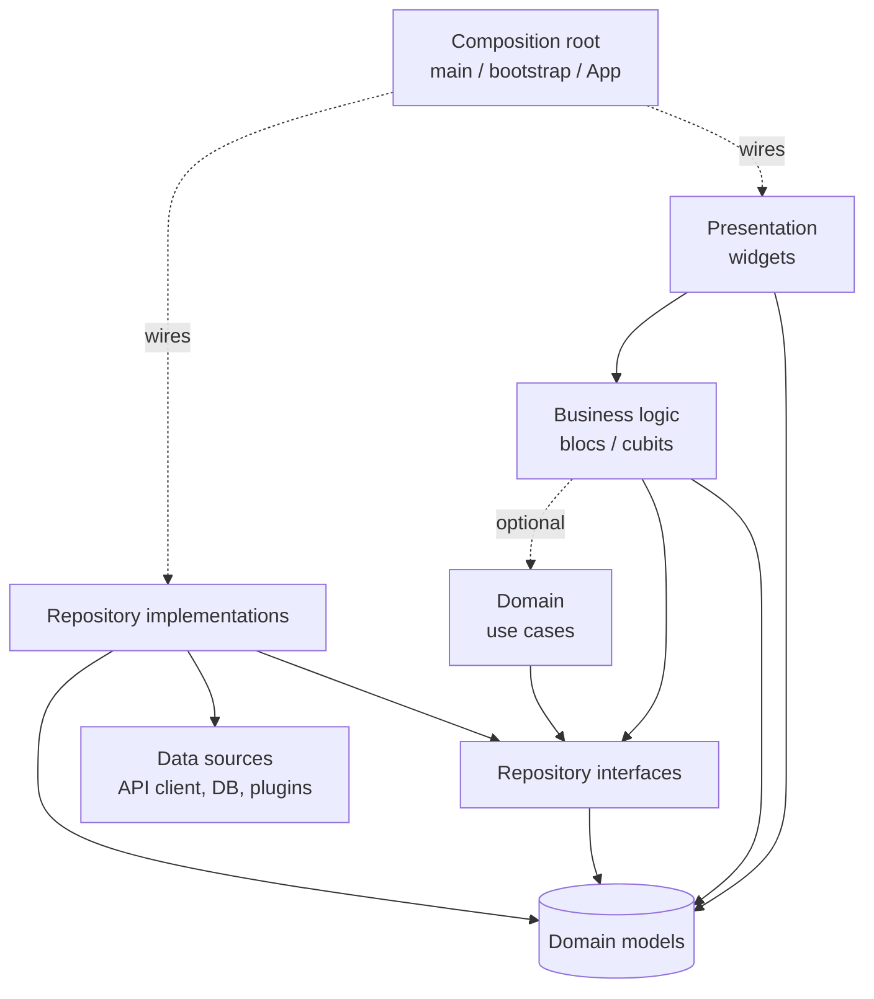

# Flutter Architecture

This page shows how we split a Flutter app into layers and packages. The app then stays **changeable, testable, and understandable** as it grows. Several teams can also work on it at the same time. [.NET › Architecture Principles](../dotnet/architecture-principles.md) contains general principles (coupling and cohesion, dependency direction, ADRs), which also apply here. [BLoC Best Practices](./bloc-best-practices.md) shows how to write blocs.

---

## Goals

| Goal | What it looks like in a Flutter app |
|------|-------------------------------------|
| **Separation of concerns** | Widgets draw; blocs decide; repositories fetch. Each kind of code has one home. |
| **Testability** | Tests of business logic need no device, network, or widgets. Tests of screens use fake blocs. |
| **Changeability** | Swapping the backend, a plugin, or a storage engine touches only the data layer. Redesigning a screen touches only widgets. |
| **Team scalability** | Features are in separate packages with clear owners. Each feature can build and run on its own. |
| **Enforced boundaries** | Illegal dependencies fail the build, not the code review. |

---

## Separation of concerns

Every piece of code in the app answers exactly one of these questions:

| Question | Layer | Made of | Knows Flutter? |
|----------|-------|---------|----------------|
| *What does it look like, and what did the user do?* | **Presentation (UI)** | Widgets, pages, views | Yes |
| *What state is the screen in, and how does it change?* | **Business logic** | Blocs and cubits | No (`package:bloc` only) |
| *What are the rules of the domain?* (optional) | **Domain** | Models, use cases, domain services | No |
| *Where does the data come from?* | **Repository** | Repository interfaces and implementations | No |
| *How do we talk to the outside world?* | **Data source** | API clients, DTOs, database, plugins wrappers | No (except plugin wrappers) |

The first four rows are the thesis's four-layer architecture (UI, BLoC, repository, data; see [BLoC › Sources](./bloc-best-practices.md#sources)) with an optional domain layer added. The table also matches the [architecture guide](https://docs.flutter.dev/app-architecture) of the Flutter team. These terms are equivalent:

- Their *view* is our widget.
- Their *view model* is our bloc.
- Their *repositories* and *services* are our repositories and data sources.

**Do**
- Keep widgets **"as stupid as possible"** (Soares): they render state and forward user input as events, nothing more.
- Put every state change in a bloc. Put every external call in a data source behind a repository.
- Keep transport details (HTTP status codes, JSON keys, SQL, method channel names) inside the data layer.

**Do not**
- Call an API client or a plugin from a widget or a bloc directly.
- Let DTOs (`DishDto`, `Map<String, dynamic>`) cross into blocs or widgets. Repositories map them to domain models.

---

## The dependency rule

Dependencies point **in one direction only**, from the volatile outside (UI, plugins, backends) towards the stable inside (models and contracts).



- Blocs depend on repository **interfaces**, never on implementations (thesis 4.2.1: the repository pattern keeps one-way dependencies).
- Models depend on nothing. Every layer may use them.
- Only the **composition root** knows which implementation goes with which interface.

This is the [dependency inversion principle](../dotnet/solid-principles.md#dependency-inversion-principle-dip) applied to Flutter.

---

## The layers in detail

### Presentation

- Pages create and provide the feature's blocs; views consume them ([BLoC › Providing blocs](./bloc-best-practices.md#providing-blocs)).
- Widgets may hold **ephemeral, purely visual** state (animation controllers, scroll and text controllers, the expanded state of a tile).
- Locale-aware formatting of values for display (dates, money) happens here or in small presentation helpers.

### Business logic

- One bloc or cubit per feature, split when it gets awkward ([BLoC › Designing blocs](./bloc-best-practices.md#designing-blocs)).
- Pure Dart: no `BuildContext`, no `dart:ui`, no plugins. That makes blocs testable with `blocTest` alone.

### Domain (optional)

Add a domain layer **only** when it earns its place:

- **Several blocs** use a rule (for example "a booking needs at least one guest and must be in the future").
- An operation **combines several repositories** (place an order = validate the booking token + submit the order + clear the basket).
- The domain has real business rules worth testing on their own.

```dart
class PlaceOrder { // not final: blocs' tests need to mock it
  const PlaceOrder(this._bookings, this._orders);

  final BookingRepository _bookings;
  final OrderRepository _orders;

  Future<OrderConfirmation> call(BookingToken token) async {
    if (!await _bookings.isValid(token)) throw const InvalidBookingTokenException();
    return _orders.placeOrder(token);
  }
}
```

**Do not** add a use case class that only forwards one call to one repository. That is ceremony without benefit; let the bloc call the repository.

### Repository

- One interface per domain concept, returning domain models and throwing domain exceptions ([BLoC › Repositories](./bloc-best-practices.md#repositories)).
- Owns caching and the **source of truth** decision: network first, cache first, or local database with background sync.
- Exposes `Stream`s for data that changes while the app runs (the current order, the signed-in user). This is how features share data without knowing about each other.

### Data source

- API clients, local storage, and plugin wrappers. One class per external system.
- Converts transport errors into typed exceptions; the repository converts those into domain exceptions.

---

## Where state lives

| Kind of state | Example | Where | Lifetime |
|---------------|---------|-------|----------|
| **Ephemeral UI state** | Animation progress, current text in a field before the user submits it, the tile that is open | `State` object, `ValueNotifier`, controllers | The widget |
| **Feature state** | Search results, the booking form, the dish list | Bloc provided at the feature's page | The feature's route |
| **App state** | Signed-in user, settings, locale, the current order | Bloc above `MaterialApp`, backed by a repository | The app session |
| **Persisted state** | Cached menu, saved drafts, auth token | Repository → database / secure storage | Across launches |

**Do**
- Pick the **smallest scope** that works, and provide blocs at the lowest common ancestor of the widgets that need them.
- Keep app-wide data in **repositories**, and let small app-level blocs or each feature's own blocs subscribe to it.
- Restore important state after the operating system kills the app in the background. Use the repository, or `hydrated_bloc` for blocs whose state must survive restarts.

**Do not**
- Keep the same data both in `setState` and in a bloc. One source of truth per piece of data.
- Make every bloc global "to be safe". Global blocs never close and keep data from the last screen around.

---

## Communication between features

Features should not know about each other's internals. When one feature needs to react to another:

| Need | Mechanism |
|------|-----------|
| Shared data (the menu changes the current order, and the order page shows it) | A **repository stream** both features subscribe to |
| One feature opens another (menu → booking) | **Navigation** by route, owned by the shell ([Navigation](#navigation-across-features)) |
| One screen links two of its own blocs | A **`BlocListener`** in that screen ([BLoC › Communication between blocs](./bloc-best-practices.md#communication-between-blocs)) |
| An app-wide event (signed out, locale changed) | An **app-level bloc or repository stream** that features listen to |

**Do not** import one feature's bloc into another feature.

---

## Feature modules ("micro frontends")

In web development, *micro frontends* split one frontend into independently built parts, each owned by one team. Flutter cannot load separately deployed code into a running mobile app, because app stores require the code in the binary. Thus, in Flutter the idea becomes **feature modules**:

- Each feature is its own **package** in a monorepo.
- One team owns each package.
- Each package has its own UI, blocs, and tests.
- A thin **shell** composes the packages into one app.

The interview with Angelov in the thesis is the strongest argument for this. Angelov's **number one tip** for large Flutter apps was to *modularize as much as possible*, and "it is not as difficult as people think". BMW split its app so that each feature could, in theory, run as its own app. The thesis only moved form validation into a package, and listed full modularization as future work.

### Why

- **Ownership:** one team, one package, clear code owners.
- **Smaller blast radius:** a change in `booking` cannot break `menu` because `menu` cannot import it.
- **Faster work:** each feature has a sandbox app that starts in seconds, and CI tests only the packages that changed.
- **Enforced architecture:** package dependencies make illegal imports impossible, instead of relying on reviews.

### Package types

| Package | Contains | May depend on | Flutter? |
|---------|----------|---------------|----------|
| `app` (shell) | `main_*.dart`, `bootstrap`, `App`, router, composition root | Everything below | Yes |
| `feature_<name>` | Pages, views, widgets, blocs of one feature; its public entry (routes) | Repositories, domain, `ui_kit`, `core` | Yes |
| `<name>_repository` | Repository interface, implementation, models | API clients, `core` | No |
| `<name>_api_client` / `local_storage` | HTTP or DB access, DTOs | `core` | No |
| `ui_kit` | Theme, design tokens, shared widgets | `core` | Yes |
| `core` | Logging, result types, small shared utilities | Nothing app-specific | No |

Features **never** depend on other features. If two features need the same thing, it moves down into a repository, `ui_kit`, or `core`.

### Layout

```text
my_app/                          # Workspace root
├── pubspec.yaml                 # workspace: [...] lists every package
├── apps/
│   └── app/                     # Shell: composes features
│       └── lib/
│           ├── bootstrap.dart
│           ├── main_development.dart
│           ├── main_production.dart
│           └── app/{app.dart, router.dart}
├── features/
│   ├── feature_menu/
│   │   ├── lib/
│   │   │   ├── feature_menu.dart        # Public API: routes + entry page only
│   │   │   └── src/{bloc/, view/, widgets/}
│   │   ├── example/                     # Sandbox app that runs this feature alone with fakes
│   │   └── test/
│   ├── feature_booking/
│   └── feature_order/
└── packages/
    ├── dish_repository/
    ├── order_repository/
    ├── booking_repository/
    ├── mts_api_client/
    ├── ui_kit/
    └── core/
```

Use **Dart pub workspaces** (a root `pubspec.yaml` with `workspace:` and `resolution: workspace` in each package) so all packages share one dependency resolution and one `pubspec.lock`. Add [Melos](https://melos.invertase.dev) if you need scripts that run across packages (test only changed packages, version and publish).

```yaml
# my_app/pubspec.yaml
name: my_workspace
publish_to: none
environment:
  sdk: ^3.12.0
workspace: # abbreviated: list every package, including each feature's example/ app
  - apps/app
  - features/feature_menu
  - features/feature_menu/example
  - features/feature_booking
  - packages/dish_repository
  - packages/ui_kit
```

```yaml
# features/feature_menu/pubspec.yaml
name: feature_menu
resolution: workspace
environment:
  sdk: ^3.12.0
dependencies:
  flutter: { sdk: flutter }
  flutter_bloc: ^9.1.1
  go_router: ^18.1.0
  dish_repository: any   # resolved from the workspace
  ui_kit: any
```

### A feature's public API

A feature exposes as little as possible: usually its routes, sometimes an entry widget. Everything else stays in `src/`.

```dart
// features/feature_menu/lib/feature_menu.dart
export 'src/menu_routes.dart' show MenuRoutes;
```

```dart
// features/feature_menu/lib/src/menu_routes.dart
abstract final class MenuRoutes {
  static const path = '/menu';

  /// Routes contributed to the shell. [onDishOrdered] lets the shell decide
  /// where to go next, so this feature never imports the order feature.
  static List<RouteBase> routes({required void Function(BuildContext) onDishOrdered}) => [
        GoRoute(
          path: path,
          builder: (context, state) => MenuPage(onDishOrdered: onDishOrdered),
          routes: [
            GoRoute(
              path: ':dishId',
              // Deep links are untrusted input: a malformed ID shows "not found", not a crash.
              builder: (context, state) =>
                  switch (int.tryParse(state.pathParameters['dishId'] ?? '')) {
                final id? => DishDetailPage(id: DishId(id)),
                null => const DishNotFoundPage(),
              },
            ),
          ],
        ),
      ];
}
```

The feature asks for what it needs from the outside (`onDishOrdered`, repositories through `context.read`) instead of reaching for it. The shell provides it. (This is why `MenuPage` takes a callback here, while the single-package version in [BLoC › Providing blocs](./bloc-best-practices.md#providing-blocs) does not need one.)

### Running a feature on its own

Each feature has an `example/` app that provides **fake repositories** and opens the feature's routes. Developers work on a feature without the backend, the login flow, or other features. This is the practical form of BMW's "each feature could run as its own app".

### When not to split

The thesis identified the cost (section 4.8.3). When every feature had its own package, packages duplicated model classes and the reference app was harder to follow. To avoid this, put shared models in repository or domain packages, not in features. Also, do not split before this is necessary:

- **One team, small app:** feature folders in one package ([BLoC › Structuring the application](./bloc-best-practices.md#structuring-the-application)), with data access already in packages.
- **Several teams, or a feature that another app reuses:** feature packages.

Because the folder structure is feature-first from the start, moving a folder into a package later is mechanical.

### Limits

- **No independent deployment.** All features ship together in one binary. Release trains, feature flags, and remote config are how teams ship independently in practice.
- **Deferred components** (Android) and **deferred imports** (web) reduce download size; they are not independent releases.
- If you really need UI that changes without an app release, use **server-driven UI** for specific screens. Those screens can show only what the widget catalogue of the app can render.

---

## Composition root

The composition root is the one place that knows every concrete class. In a Flutter app that is `main_<flavor>.dart` → `bootstrap()` → `App`.

**Do**
- Read configuration (`--dart-define-from-file`), create API clients and repositories, choose real or fake implementations per flavor, and provide them with `MultiRepositoryProvider` ([BLoC › Dependency injection](./bloc-best-practices.md#dependency-injection)).
- Install error handlers and the `BlocObserver` in `bootstrap()` ([Flutter › Error handling](./flutter-best-practices.md#error-handling-and-logging)).
- Assemble the router from each feature's routes.

```dart
// apps/app/lib/main_production.dart
Future<void> main() async {
  final apiClient = MtsApiClient(baseUrl: const String.fromEnvironment('API_BASE_URL'));
  await bootstrap(() => App(
        dishRepository: HttpDishRepository(apiClient),
        orderRepository: HttpOrderRepository(apiClient),
        bookingRepository: HttpBookingRepository(apiClient),
      ));
}
```

**Do not**
- Create dependencies anywhere else, or reach for a global locator inside features.

---

## Navigation across features

**Do**
- Let the **shell own the router**. Each feature contributes its routes; the shell combines them and decides cross-feature flows.
- Let features signal "done" or "go elsewhere" through callbacks or route names supplied by the shell, not by importing another feature's page.
- Drive redirects (signed out → login) from an app-level auth bloc or repository stream, connected to `GoRouter.refreshListenable` through a small `Listenable` adapter.

```dart
// apps/app/lib/app/router.dart
// StreamListenable is our own ~10-line ChangeNotifier that calls notifyListeners()
// on every stream event; go_router does not ship one.
GoRouter buildRouter(AuthRepository auth) => GoRouter(
      refreshListenable: StreamListenable(auth.status),
      // Skip the redirect when already on the login page, or go_router detects a loop.
      redirect: (context, state) => auth.currentStatus == AuthStatus.signedOut &&
              state.matchedLocation != LoginRoutes.path
          ? LoginRoutes.path
          : null,
      routes: [
        ...LoginRoutes.routes(),
        ...MenuRoutes.routes(onDishOrdered: (context) => context.go(OrderRoutes.path)),
        ...OrderRoutes.routes(),
        ...BookingRoutes.routes(),
      ],
    );
```

---

## Error flow across layers

Each layer translates errors into the language of the layer above it:

| Layer | Receives | Produces |
|-------|----------|----------|
| Data source | `SocketException`, `TimeoutException`, HTTP 5xx, malformed JSON | `ApiException` subtypes (`ApiTimeoutException`, `ApiServerException`) |
| Repository | `ApiException` | Domain exceptions (`DishSearchException`, `BookingRejectedException`) |
| Bloc | Domain exceptions | Failure states with a reason the UI can show |
| UI | Failure states | Error message and a recovery action ([UI/UX › States](./flutter-ui-ux-guidelines.md#loading-empty-error-and-success-states)) |

Unexpected errors (bugs) are not translated. They go to `Bloc.observer.onError` and the global error handlers, and from there to the crash reporter.

---

## Enforcing boundaries

**Do**
- Use **package dependencies** as the main guard. If `feature_menu`'s `pubspec.yaml` does not list `feature_order`, importing it is a compile error.
- Keep repositories, API clients, and `core` as **pure Dart packages** (no `flutter` dependency). This guarantees that they contain no UI code, and that `dart test` can test them.
- Inside a package, keep everything under `src/` and export only the public API. The `implementation_imports` lint stops other packages from reaching into `src/`.
- Add a CI check that fails when a package has a dependency that its type does not allow. For example, use a script over each `pubspec.yaml`, or a custom lint rule with `custom_lint`.
- Record significant architecture decisions as [ADRs](../adr).

---

## Testing per layer

| Layer | Test with | Fakes at |
|-------|-----------|----------|
| Models, use cases | `package:test` | Repositories |
| Blocs / cubits | `bloc_test` | Repositories |
| Repositories | `package:test` | API clients / storage |
| API clients | `package:test` with a mock HTTP client | The HTTP layer |
| Widgets / views | `flutter_test` | Blocs (`MockBloc`) |
| Feature flows | Widget tests of the feature's routes, or its `example/` app | Repositories |
| Whole app | `integration_test` on a device | Backend (staging or a fake server) |

Each package runs its own tests. CI runs only the tests of packages that changed and the packages that depend on them.

---

## When to keep it lighter

Not every app needs every layer or package.

| App | Reasonable shape |
|-----|------------------|
| Prototype or tiny tool | One package; cubits; repositories as plain classes. Keep widgets free of I/O anyway. |
| Single-team product | One app package with feature folders; repositories and API client in pure Dart packages. No domain layer until several parts share rules. |
| Multi-team or long-lived product | Full feature-module monorepo as described above. |

Start with the smallest shape that keeps the [dependency rule](#the-dependency-rule). The rule is what makes it cheap to grow into the next shape later.

---

## Anti-patterns

| Anti-pattern | Symptom | Fix |
|--------------|---------|-----|
| **Fat widgets** | `build` methods with `if` chains on business rules; HTTP calls in `onPressed` | Move rules to blocs, I/O to repositories |
| **Layer skipping** | A bloc imports the API client; a widget imports a repository implementation | Depend on interfaces; wire at the composition root |
| **Feature-to-feature imports** | `feature_menu` imports `feature_order/src/...` | Shared data in repositories; navigation through the shell |
| **God `core`/`common` package** | Everything shared ends up in one package that everything depends on | Put shared code where it belongs: models in repositories, widgets in `ui_kit` |
| **Splitting too early** | Ten packages, one developer, constant version juggling | Feature folders first; packages when teams or reuse demand it |
| **DTOs in the UI** | Widgets read `json['name']` or `DishDto` | Map to domain models in the repository |

---

## Review checklist

- [ ] Widgets contain no business rules or I/O; blocs contain no Flutter imports.
- [ ] Blocs depend on repository interfaces, not implementations or API clients.
- [ ] DTOs and transport errors do not leave the data layer.
- [ ] State lives at the smallest scope that works; one source of truth per piece of data.
- [ ] No feature imports another feature; cross-feature flows go through the shell or a repository.
- [ ] Feature packages export only their routes / entry point.
- [ ] Repository, API client, and `core` packages are pure Dart.
- [ ] Only the composition root creates concrete classes.
- [ ] Each layer boundary translates errors. Unexpected errors go to the crash reporter.
- [ ] A domain/use-case layer exists only where several parts share rules, or rules combine repositories.
